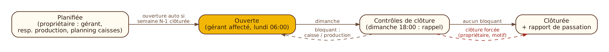
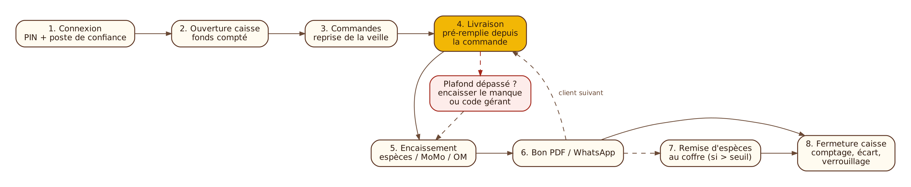
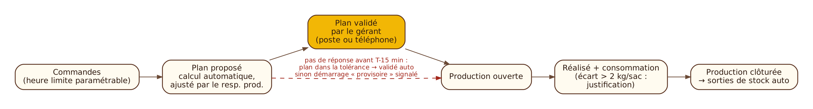
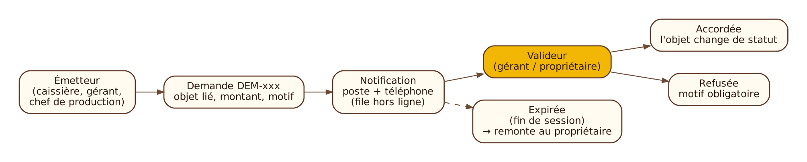

# OptiBoul ERP — Cahier des charges

**Boulangerie du Faubourg · Etoudi, Yaoundé**  
Version 5 · 20 octobre 2026  
Préparé par Dongmo Noukouankouang Baudouin

> Fusionne le cahier des charges du prototype (version 4 du 20 octobre 2026) et la version 4 consolidée du 14 octobre. Documents associés : Parcours utilisateurs et UX v3, Backlog produit v2, Spécification technique et architecture v3.

## Sommaire

- [0. Historique et nouveautés de la version 5](#0-historique-et-nouveautés-de-la-version-5)
- [1. Contexte et objectifs](#1-contexte-et-objectifs)
- [2. Périmètre](#2-périmètre)
- [3. Profils et groupes d'utilisateurs](#3-profils-et-groupes-dutilisateurs)
- [4. Connexion et sécurité](#4-connexion-et-sécurité)
- [5. Modules fonctionnels](#5-modules-fonctionnels)
- [6. Règles de gestion](#6-règles-de-gestion)
- [7. Exigences non fonctionnelles](#7-exigences-non-fonctionnelles)
- [8. Identité visuelle](#8-identité-visuelle)
- [9. Paramètres par défaut](#9-paramètres-par-défaut)
- [10. Données de démonstration](#10-données-de-démonstration)
- [11. Points à confirmer](#11-points-à-confirmer)

## 0. Historique et nouveautés de la version 5

| Version | Date | Contenu |
| --- | --- | --- |
| 1 | 10 octobre 2026 | Analyse des besoins à partir du cahier des charges initial et du fichier de septembre 2026 |
| 2 | 13 octobre 2026 | Intégration des réponses de la boulangerie (plafond, sessions jour/nuit, farine à crédit, nom, couleurs) |
| 3 | 14 octobre 2026 | Cahier des charges issu du prototype cliquable : semaines, caisses, groupes, demandes, réceptions, paie |
| 4 consolidée | 14 octobre 2026 | Parcours optimisés (O1 à O16), règles complétées, paramètres réunis, architecture alignée |
| 4 prototype | 20 octobre 2026 | Prototype mis à jour : relance des clients habituels, origine de la demande, augmentation de production, reste à produire, fiche technique avec coût de revient, stock à date, deux contrôles de stock par semaine, centre de notifications |
| 5 | 20 octobre 2026 | Fusion des deux versions 4 : nouveautés du prototype intégrées, optimisations conservées et étendues (O17, O18), règles renumérotées (R15–R16 du prototype, R17–R22 ajoutées) |

### Nouveautés reprises du prototype du 20 octobre

| Domaine | Nouveauté | Section |
| --- | --- | --- |
| Commandes | Clients habituels sans commande affichés et relancés ; reprise de la commande habituelle ; commande tardive signalée au chef et au gérant | 5.3 |
| Production | Plan = commandes + demande estimée + supplément du chef ; augmentation de production motivée ; reste à produire en temps réel | 5.5 |
| Fiches techniques | Ingrédients par sac, rendement, coût de revient par pain, marge, procédé, versions tracées | 5.5 |
| Stocks | Stock à date ; contrôles physiques obligatoires le mercredi et le dimanche | 5.6 |
| Demandes | Nouveau type : augmentation de production après validation du plan | 5.9 |
| Notifications | Centre de notifications avec compteur, envoi ciblé par rôle | 5.13 |
| Règles | R15 (augmentation après validation) et R16 (deux contrôles de stock par semaine) | 6 |

### Optimisations conservées et ajoutées

La version 5 garde les optimisations de la version 4 consolidée, qui évitent de ralentir le comptoir ou de bloquer l'activité la nuit, et en ajoute deux pour les nouveautés du prototype (O17, O18). Tous les seuils restent réunis dans la table de paramètres (section 9).

| Réf. | Optimisation | Prototype | Version 5 | Gain attendu |
| --- | --- | --- | --- | --- |
| O1 | Connexion adaptée au lieu | 2FA SMS/WhatsApp à chaque connexion, même au comptoir | Au comptoir : code à 4 chiffres sur un poste de confiance ; double authentification à la première connexion du jour pour gérant, propriétaire et administrateur, et à chaque accès à distance. Hors ligne : code d'application d'authentification ou code de secours. | Le SMS exige le réseau et coûte à chaque connexion ; une caissière change d'utilisateur en 3 secondes au lieu d'attendre un SMS. |
| O2 | Caisse et session fusionnées | Fermeture de caisse (§5.2) et clôture de session (§5.3) séparées, avec deux comptages | Une caisse par créneau = la session de vente. Un seul comptage, une seule fermeture qui verrouille livraisons, encaissements et dépenses de caisse. | Un comptage en moins par session, aucun écart entre deux totaux. |
| O3 | Livraison pré-remplie et commandes habituelles | Quantités ressaisies à la livraison ; relance des clients habituels manuelle (prototype v4) | Les quantités commandées sont proposées ; « Livrer comme commandé » en une touche. La commande habituelle d'un client se reprend en un clic quand il confirme ; la caissière ne corrige que les écarts. | Saisie divisée par deux pour les clients réguliers. |
| O4 | Remise d'espèces au coffre | Toutes les espèces restent dans la caisse jusqu'à la fermeture | Au-delà d'un plafond d'espèces en caisse (100 000 FCFA par défaut), le logiciel propose une remise au coffre ou au gérant, tracée et prise en compte dans l'écart. | Moins d'argent exposé la nuit, écart toujours juste. |
| O5 | Validation à distance | Autorisations saisies sur le poste par le gérant | Toute demande est envoyée aussi sur le téléphone du valideur ; accord en un clic. Le code gérant sur le poste reste possible. Sans réponse à l'échéance, la demande remonte au propriétaire. | La nuit, le gérant absent ne bloque plus le comptoir. |
| O6 | Plan de production sans blocage | Production impossible tant que le gérant n'a pas validé le plan | Si le gérant ne répond pas 15 min avant le pétrissage, un plan dans la tolérance (±10 % de la moyenne des 4 dernières sessions du même créneau) est validé automatiquement ; sinon la production démarre « provisoire » et remonte en alerte. | Le pétrissage ne prend jamais de retard. |
| O7 | Achats courants pré-autorisés | Toute dépense ≥ 50 000 FCFA demande une validation | Le gérant pré-autorise en début de semaine les achats courants (bois, levure, glace…) avec un plafond par catégorie ; dans ce cadre, aucune demande n'est émise. | Le bois (≈ 150 000 FCFA) n'exige plus une validation à chaque achat. |
| O8 | Semaine qui s'enchaîne seule | Ouverture manuelle, bloquée si la semaine précédente n'est pas clôturée | Rappel le dimanche à 18:00, ouverture automatique le lundi à 06:00 si tout est prêt ; clôture forcée possible par le propriétaire avec motif ; dettes non soldées reportées et marquées. | Plus de lundi bloqué par une clôture oubliée. |
| O9 | Planification en un geste | Affectations et planning des caisses saisis chaque semaine | « Copier la semaine précédente » et proposition de rotation des gérants et responsables de production ; conflits signalés (même personne sur deux créneaux). | Planifier une semaine prend 2 minutes. |
| O10 | Accueil selon le profil | Même tableau de bord pour tous | Caissière : Ma caisse. Chef de production : Plan du jour. Gérant : Ma semaine (liste de tâches). Propriétaire : Tableau de bord et demandes. | Chacun arrive directement sur sa tâche. |
| O11 | Relances de dettes planifiées | Relances WhatsApp manuelles | Relances automatiques le jeudi et le samedi pour les dettes à régler avant dimanche ; relance manuelle toujours possible. | Moins de dettes reportées d'une semaine à l'autre. |
| O12 | Réception en un clic | Réception saisie à partir d'une fiche vide | La réception s'ouvre depuis la livraison planifiée, quantité prévue pré-remplie ; tout écart crée automatiquement le manquant à livrer. | Aucun manquant oublié. |
| O13 | Contrôles de stock guidés | Deux contrôles physiques par semaine (mercredi, dimanche) sur toutes les matières (prototype v4) | Contrôle à l'aveugle (stock théorique masqué) sur une liste pré-remplie ; le mercredi porte sur les matières clés (farine, levure, améliorant), le dimanche sur toutes ; inventaire complet une fois par mois. | Contrôle du mercredi en 5 minutes, comptages plus honnêtes. |
| O14 | Absences proposées pour la paie | Absences saisies à la main | Une caisse planifiée non ouverte par la personne prévue propose une absence au gérant, qui confirme ou corrige. | Paie plus juste, moins d'oublis. |
| O15 | Envois hors ligne en file | Bons et relances WhatsApp supposent internet | Bons, relances, codes et notifications passent par une file d'envoi rejouée au retour du réseau ; le bon reste disponible à l'écran et en PDF. | Aucune action du comptoir ne dépend du réseau. |
| O16 | Thème sombre la nuit | Thème choisi à la main | Thème sombre proposé par défaut pendant la session de nuit. | Moins de fatigue visuelle au comptoir de nuit. |
| O17 | Petit supplément sans attendre | Toute augmentation de production après validation du plan demande l'accord du gérant (prototype v4) | Un supplément faible (≤ 1 sac par produit et ≤ 10 % du plan) est accordé automatiquement si le stock de farine le permet ; au-delà, demande au gérant (poste ou téléphone, O5). Le gérant est toujours informé. | Pas d'attente la nuit pour un sac de plus. |
| O18 | Relance automatique avant l'heure limite | Relance des clients habituels déclenchée à la main par la caissière (prototype v4) | 30 minutes avant l'heure limite des commandes, les clients habituels sans commande reçoivent automatiquement un rappel WhatsApp (file d'envoi) ; la caissière voit qui a répondu. | Moins de commandes tardives qui perturbent le plan. |

## 1. Contexte et objectifs

La Boulangerie du Faubourg produit deux fois par jour sur un seul site : la session de **jour (06:00–18:00)** et la session de **nuit (18:00–06:00)**, la plus importante. Elle livre des clients livreurs, des restaurants et des hôtels, souvent à crédit. La gestion est confiée à un **gérant qui change chaque semaine**, sous le contrôle du propriétaire.

En septembre 2026, elle a produit 121 603 pains et encaissé 9 786 075 FCFA auprès d'une soixantaine de clients ; le suivi se faisait dans un classeur Excel mensuel.

1. Saisir livraisons et encaissements au comptoir en moins de 30 secondes par client, sans erreur de calcul.
2. Maîtriser les dettes clients : plafond, échéance du dimanche, relances.
3. Planifier la production à partir des commandes et contrôler la consommation des matières.
4. Suivre le stock, les fournisseurs, les réceptions et les dettes fournisseurs.
5. Rattacher chaque opération à une **semaine** et à des **responsables identifiés**.
6. Préparer, valider et payer la paie dans le logiciel.
7. Tracer toutes les actions et sécuriser l'accès, sans jamais dépendre d'internet au comptoir.

## 2. Périmètre

| Inclus en version 1 | Exclu de la version 1 |
| --- | --- |
| Connexion sécurisée, rôles, groupes, postes de confiance | Comptabilité générale (bilan, TVA) |
| Semaines, planning, caisses (sessions), commandes, livraisons | Paiement mobile money intégré par API (référence saisie à la main) |
| Production, recettes, stocks, inventaires | Application pour les clients finaux |
| Fournisseurs, réceptions, factures, paiements | Plusieurs boulangeries |
| Dépenses, budget, achats pré-autorisés, demandes de validation | Viennoiserie et pâtisserie |
| Paie mensuelle |  |
| Tableau de bord, alertes, notifications, journal, sauvegardes |  |

## 3. Profils et groupes d'utilisateurs

### 3.1 Profils de droits

| Profil | Rôle principal | Écran d'accueil (O10) |
| --- | --- | --- |
| Caissier / caissière | Ouvre et ferme sa caisse ; saisit commandes, livraisons, encaissements, mouvements internes, remises au coffre et dépenses de caisse | Ma caisse |
| Gérant de la semaine | Pilote la semaine : valide le plan, autorise les dépassements, pré-autorise les achats courants, planifie et réceptionne, paie les fournisseurs, prépare et paie la paie, clôture la semaine | Ma semaine (liste de tâches) |
| Responsable de production | Ajuste et propose le plan, ouvre et clôture la production, saisit réalisé et consommation, fait les inventaires tournants | Plan du jour |
| Propriétaire | Planifie les semaines, valide les demandes qui lui reviennent, force une clôture si besoin, suit la rentabilité | Tableau de bord et demandes |
| Administrateur | Comptes, groupes, postes de confiance, sauvegardes, paramètres techniques | Administration |

### 3.2 Groupes d'utilisateurs

Un utilisateur appartient à **un groupe** ; le groupe porte le profil de droits. Groupes de départ : Caisse – équipe de nuit, Caisse – équipe de jour, Gérants de la semaine, Production, Direction, Support informatique.

L'administrateur crée un groupe (nom, profil, description) et change un utilisateur de groupe ; les droits changent immédiatement et le changement est tracé. Le rôle « gérant de la semaine » ou « responsable de production de la semaine » s'ajoute aux droits du groupe pendant la semaine d'affectation seulement.

### 3.3 Matrice des droits

| Fonction | Caissier | Gérant | Resp. prod. | Propriétaire | Admin |
| --- | --- | --- | --- | --- | --- |
| Ouvrir / fermer sa caisse | Oui | Oui | — | — | — |
| Rouvrir une caisse fermée | — | Oui | — | Oui | — |
| Livraisons et encaissements | Saisir | Saisir | — | Voir | — |
| Livraison au-delà du plafond | Demander | Autoriser | — | Autoriser | — |
| Remise d'espèces au coffre | Saisir | Recevoir | — | Voir | — |
| Planifier la semaine, affectations, planning caisses | — | Planning caisses | — | Oui | — |
| Ouvrir / clôturer la semaine | — | Semaine affectée | — | Oui (+ clôture forcée) | — |
| Proposer / ouvrir / clôturer la production | — | — | Semaine affectée | — | — |
| Valider le plan de production | — | Semaine affectée | — | Oui | — |
| Pré-autoriser les achats courants | — | Oui | — | Oui | — |
| Réceptions et paiement fournisseurs | — | Oui | Réceptionner | Voir | — |
| Augmentation de production après validation | — | Accorder | Demander | Accorder | — |
| Contrôles de stock (mercredi, dimanche) | — | Oui | Oui | Voir | — |
| Inventaire | — | Oui | Oui | Valider si écart > 5 % | — |
| Fiches techniques (recette, coût, marge) | — | Voir | Voir | Modifier | Modifier |
| Dépenses | Saisir | Saisir et valider | Saisir (production) | Valider | — |
| Paie | — | Préparer et payer | — | Valider | — |
| Paramètres métier (plafonds, seuils, produits) | — | — | — | Oui | Voir |
| Comptes, groupes, postes, sauvegardes | — | — | — | — | Oui |

## 4. Connexion et sécurité

### 4.1 Méthodes de connexion (O1)

| Contexte | Méthode | Double authentification |
| --- | --- | --- |
| Poste du comptoir enregistré comme poste de confiance | Choix du nom + code à 4 chiffres | Non pour la caissière et le responsable de production ; oui à la première connexion du jour pour gérant, propriétaire et administrateur |
| Autre appareil sur le réseau de la boulangerie | E-mail + mot de passe | Oui, à chaque connexion |
| Accès à distance (téléphone, hors boulangerie) | Continuer avec Google ou e-mail + mot de passe | Oui, à chaque connexion |

- Code à 6 chiffres envoyé par **SMS** ou **WhatsApp** au numéro du compte (affiché masqué), vérifié dès le 6ᵉ chiffre ; renvoi après 30 secondes ou bascule vers l'autre canal ; 3 essais puis nouveau code.
- **Sans réseau** : code d'une application d'authentification (TOTP) ou l'un des 10 codes de secours remis à la création du compte.
- Mot de passe oublié, afficher le mot de passe, langue FR / EN et thème clair / sombre sur l'écran de connexion.

### 4.2 Règles de session

- Déconnexion automatique après inactivité : 1, 5, 10 ou 15 minutes (5 par défaut au comptoir).
- « Changer d'utilisateur » toujours visible ; la saisie en cours est conservée en brouillon pour la personne qui l'a commencée.
- Chaque connexion est tracée : méthode, poste, canal de vérification, réussite ou échec. 5 échecs de code bloquent le compte 15 minutes.
- L'écran de connexion affiche l'heure, la session en cours, le gérant de la semaine et l'état en ligne / hors ligne.

## 5. Modules fonctionnels

### 5.1 Semaines de travail

La semaine (lundi 06:00 – dimanche 06:00 suivant) est l'**unité de rattachement** de toute l'activité. Cycle de vie : Planifiée → Ouverte → Clôturée.

*Cycle de vie de la semaine (O8)*

| Étape | Qui | Conditions |
| --- | --- | --- |
| Planification | Propriétaire | Gérant et responsable de production affectés ; « copier la semaine précédente » et rotation proposée (O9) |
| Planning des caisses | Propriétaire ou gérant | Une caissière par créneau (7 jours × jour/nuit) ; conflits signalés |
| Ouverture | Automatique le lundi 06:00, ou gérant affecté / propriétaire | Semaine précédente clôturée, affectations faites |
| Clôture | Gérant de la semaine ou propriétaire | Aucune caisse ouverte, aucune production en cours ; rappel le dimanche 18:00 |
| Clôture forcée | Propriétaire | Motif obligatoire ; les éléments ouverts sont archivés « non clôturés » et remontent en alerte |

- **Contrôles avant clôture** – bloquants : caisse ouverte, production non clôturée ; à voir : dettes clients, factures en retard, demandes en attente, contrôle de stock du dimanche non fait.
- **Rapport de passation** (PDF, envoyé au gérant suivant) : caisses et écart cumulé, dettes clients reportées, dettes fournisseurs, stock bas, incidents (écarts matière, réouvertures, demandes en attente, productions provisoires).
- **Indicateurs de la semaine** : recette, dépenses, sacs produits, écart de caisse cumulé, dettes reportées.

### 5.2 Caisses (sessions de vente)

**Une caisse par créneau** : elle est la session de vente (O2). Elle porte commandes, livraisons, encaissements, mouvements internes, remises au coffre et dépenses de caisse.

- **Ouverture** : la caissière compte le fonds (20 000 FCFA par défaut). La caissière planifiée est proposée ; si une autre personne ouvre, c'est signalé au gérant et tracé.
- **Remise au coffre (O4)** : au-delà de 100 000 FCFA d'espèces en caisse, le logiciel propose une remise au coffre ou au gérant ; montant, heure et receveur sont tracés.
- **Fermeture** : un seul comptage. Attendu = fonds + espèces encaissées − dépenses de caisse − remises au coffre. Statut juste / manque / excédent. La fermeture verrouille toutes les saisies de la caisse.
- **Réouverture** : gérant ou propriétaire uniquement, motif obligatoire, tracée.
- **Historique** par jour et par caissière ; récapitulatif par caissière (ouvertures, recette, écart cumulé). Une caissière ne voit que ses caisses.

### 5.3 Commandes et livraisons

*Parcours optimisé d'une caisse (O1, O3, O4)*

- **Commandes** par client et par produit, jusqu'à l'heure limite paramétrable (18:30 pour la nuit, 05:30 pour le jour) ; elles calculent les sacs à pétrir.
- **Relance des clients habituels** : au-dessus des commandes, la liste des clients qui commandent d'habitude à cette session et n'ont pas encore commandé. Rappel WhatsApp automatique 30 min avant l'heure limite (O18) ; relance manuelle, un par un ou tous ; reprise de la commande habituelle en un clic s'ils confirment par téléphone (O3).
- **Commande tardive** : une commande ajoutée après la validation du plan est signalée au chef et au gérant ; elle alimente le supplément de production (5.5).
- **Livraison** : recherche du client par les premières lettres puis Entrée ; quantités pré-remplies depuis la commande, « Livrer comme commandé » en une touche ; montant dû selon le tarif du client.
- **Encaissement** : espèces, MTN MoMo ou Orange Money (référence obligatoire), paiement partiel, remboursement d'une ancienne dette ; reste et solde après livraison affichés.
- **Plafond de dette** (2 000 FCFA par défaut) : au-delà, la livraison est bloquée ; la caissière encaisse le manque ou émet une demande, validée par code gérant sur le poste ou à distance (O5).
- **Bon de livraison** à l'écran, en PDF ou par WhatsApp (mis en file si hors ligne, O15) ; ticket thermique dès l'achat de l'imprimante.
- **Mouvements internes** : vente au guichet, retours, reste en salle, ration ; motif obligatoire.

### 5.4 Clients et dettes

- Fiche client : nom, type (client livreur, restaurant, hôtel, particulier), téléphone, tarif par produit, plafond propre (par défaut le plafond général).
- Solde calculé à partir des mouvements, jauge par rapport au plafond, statut à jour / dette / plafond dépassé.
- Toute dette est réglée au plus tard le dimanche ; relances automatiques jeudi et samedi (O11), relance manuelle individuelle ou groupée.
- Relevé client en PDF ou WhatsApp avec l'historique ; reprise des soldes du classeur Excel au démarrage.

### 5.5 Production

*Cycle de production par session (O6)*

| Étape | Qui | Nuit / jour (paramétrable) |
| --- | --- | --- |
| Commandes | Caissière de la session | Jusqu'à 18:30 / 05:30 |
| Plan proposé | Calculé automatiquement, ajusté par le responsable de production | Vers 18:45 / 05:45 |
| Plan validé | Gérant (poste ou téléphone) ; validation automatique si dans la tolérance et sans réponse à T-15 min | Avant le pétrissage |
| Production ouverte | Responsable de production | Vers 19:00 / 06:30 |
| Production clôturée | Responsable de production | Vers 05:00 / 13:30 |

- **Plan** : sacs par produit, pains prévus, boules, à partir des fiches techniques (BAG 315 pains/sac, KO 426, GC 135 216, GC 170 175, PL 216, C2 216, PSL 150).
- **Origine de la demande** : le plan additionne trois sources, affichées séparément :
  - les commandes clients saisies par la caissière ;
  - la demande estimée : clients habituels sans commande et ventes au guichet, en moyenne sur les 4 dernières sessions du même type ;
  - le supplément décidé par le chef de production.
- **Augmentation de production** : le chef compare commandes, demande estimée et plan, puis ajoute des sacs par produit avec un motif obligatoire (clients habituels, guichet, marché ou événement, commande tardive) ; le stock de farine disponible est affiché.
  - avant validation du plan : le supplément s'ajoute au plan et est validé avec lui ;
  - après validation : supplément faible (≤ 1 sac par produit et ≤ 10 % du plan, farine suffisante) accordé automatiquement et notifié au gérant (O17) ; au-delà, demande au gérant (poste ou téléphone) ; une fois accordé, il s'ajoute au plan et aux sorties de stock.
- **Reste à produire** : prévu − réalisé par produit, mis à jour à chaque fournée saisie, visible par le chef, le gérant et la caisse.
- **Fiche technique produit** (depuis le plan et les paramètres) : ingrédients pour un sac de 50 kg, rendement (poids de boule, pains par boule, pains par sac), coût de revient par pain, marge, procédé ; modifiable par le propriétaire et l'administrateur, versions tracées. Le plan d'une session garde la version de fiche utilisée.
- **Réalisé** : pains réellement produits, saisis par fournée ; écart en pains et en pourcentage.
- **Consommation réelle** (farine, sel, levure, améliorant, glace, bois, huile) avec la valeur théorique à côté de chaque champ ; au-delà de **2 kg d'écart par sac** (ou 4 % de la recette pour les intrants en grammes), justification obligatoire (perte, raté, brûlé, erreur de pesée, autre) et information du gérant.
- **Clôture** : impossible sans réalisé et consommation ; crée automatiquement les sorties de stock. Une production non clôturée à l'ouverture de la session suivante est archivée « non clôturée » et remonte en alerte.

### 5.6 Stocks

- **État** par matière : quantité, besoin par session, sessions restantes, prochaine réception, valeur, statut suffisant / à commander / stock bas.
- **Entrées** : réceptions fournisseurs, achats en caisse rattachés au stock, corrections manuelles motivées. **Sorties** : clôtures de production, pertes et casse (motif obligatoire).
- **Stock à date** : stock au soir de n'importe quel jour, avec entrées, sorties et ajustements du jour et le dernier comptage physique ; calculé depuis le dernier inventaire validé et les mouvements enregistrés depuis.
- **Contrôles obligatoires deux fois par semaine** : le mercredi après la production de jour et le dimanche à la clôture de la semaine, par le gérant de la semaine avec le responsable de production. Statuts prévu / à faire aujourd'hui / fait / manqué ; rappel le jour du contrôle ; un contrôle manqué remonte en alerte (R16).
- **Contrôle guidé (O13)** : comptage à l'aveugle sur une liste pré-remplie ; le mercredi porte sur les matières clés (farine, levure, améliorant), le dimanche sur toutes les matières ; inventaire complet une fois par mois.
- **Ajustement** : écart ≤ 5 % appliqué immédiatement ; écart > 5 % soumis au propriétaire, appliqué après accord. Historique avec auteur, valideur et écarts.

### 5.7 Fournisseurs et réceptions

- **Fiche fournisseur** : matières, téléphone, conditions de paiement, dette, prochaine réception, manquants.
- **Planification des réceptions** par le gérant : fournisseur, matière, quantité, date prévue.
- **Réception en un clic (O12)** depuis la réception planifiée : quantité prévue pré-remplie, quantité comptée, observation ; crée l'entrée de stock et la facture (farine cumulée sur la facture de la semaine). Tout écart crée le manquant à livrer, relançable ou replanifiable.
- **Factures** : à payer, en cours, en retard, payée. Le paiement (espèces, banque, mobile money) crée une dépense rattachée au stock et un reçu PDF. Farine : livrée à crédit, payée le lundi ou mardi suivant (19 525 FCFA le sac, à confirmer).

### 5.8 Dépenses et budget

- **Budget mensuel** par catégorie : matières premières, salaires, électricité, eau, administration, technique, petit matériel, lait supplément salaire, extra ; statut OK / à surveiller (≥ 80 %) / dépassé.
- **Saisie** : catégorie, libellé, montant, payé par (caisse, banque, mobile money), photo du justificatif ; auteur et profil enregistrés ; numéro DEP-xxxx et semaine.
- **Rattachement obligatoire** : production en cours, semaine (frais généraux) ou stock (matière, quantité, fournisseur ou marché ; l'entrée de stock est créée).
- **Achats pré-autorisés (O7)** : le gérant fixe en début de semaine un plafond par catégorie courante (bois, levure, glace, sel, huile) ; une dépense dans ce cadre ne crée pas de demande.
- **Seuil de validation** (50 000 FCFA) hors pré-autorisation : demande au gérant si la dépense vient d'une caissière, au propriétaire si elle vient du gérant.

### 5.9 Demandes de validation

*Circuit d'une demande (O5)*

| Type | Émise par | Validée par | Échéance | Objet lié |
| --- | --- | --- | --- | --- |
| Livraison au-delà du plafond | Caissière | Gérant ou propriétaire | 10 min, puis propriétaire | Client et livraison |
| Dépense au-dessus du seuil | Caissière / gérant | Gérant / propriétaire | Fin de session | Dépense DEP-xxxx |
| Plan de production | Responsable de production | Gérant | T-15 min avant pétrissage (O6) | Production |
| État de paie | Gérant | Propriétaire | Jour de paie − 2 jours | Paie du mois |
| Inventaire avec écart > 5 % | Gérant / resp. production | Propriétaire | 48 h | Inventaire AUD-xx |
| Augmentation de production après validation du plan (au-delà du seuil O17) | Chef de production | Gérant de la semaine ou propriétaire | 10 min, puis propriétaire | Plan de la session |
| Réouverture de caisse | Gérant | — (tracée, propriétaire informé) | — | Caisse |

- Numéro DEM-xxx, émetteur, profil, heure, destinataire, lien vers l'objet ; notification sur le poste et le téléphone du valideur (O5) ; accord ou refus tracé, refus motivé ; l'objet lié change de statut automatiquement.

### 5.10 Personnel et paie

- **Calcul** : net = base − absences − avances − pénalités + gains + impayé antérieur ; une absence vaut base ÷ 26.
- **Absences proposées (O14)** depuis le planning des caisses ; le gérant confirme ou corrige.
- Gains et pénalités multiples, chacun avec description, montant, date et auteur ; modifiables tant que l'état est en brouillon.
- **Parcours** : Brouillon → Soumis → Validé → Paiement (individuel ou global, partiel possible) → Payée. Le reste non payé devient un impayé repris le mois suivant.
- Jour de paie planifié et calendrier ; chaque paiement crée une dépense « Salaires » rattachée à la semaine ; bulletins en PDF.

### 5.11 Tableau de bord et accueil par profil

- Indicateurs : recette du mois et taux d'encaissement, dettes clients et fournisseurs, semaine en cours (gérant, responsable de production), écart de caisse cumulé, marge estimée.
- Graphiques : recette par session, production par produit, budget par catégorie.
- Alertes cliquables : factures en retard, stock bas, plafonds dépassés, budget dépassé, production non clôturée ou provisoire, manquants fournisseurs, manques de caisse, demandes en attente, écarts matière, contrôle de stock manqué, demande estimée au-dessus du plan, sauvegarde cloud en retard.
- **Ma semaine** (gérant) : liste de tâches datées issue des règles (valider le plan, payer la farine lundi, contrôle de stock mercredi et dimanche, relancer les dettes, clôturer dimanche).

### 5.12 Administration

- **Utilisateurs** en 3 étapes avec aperçu des accès : identité (nom, Gmail, téléphone +237 à 9 chiffres commençant par 6), groupe, canal de vérification et invitation ; e-mail unique.
- Réinitialisation du code, désactivation, changement de groupe ; **postes de confiance** : enregistrement et révocation.
- **Sauvegardes** : locale toutes les 4 h et à chaque clôture (caisse, production, semaine) ; cloud chiffrée avec alerte au-delà de 48 h ; restauration guidée.
- **Journal** non modifiable : toutes les opérations avec auteur, profil, poste et heure, valeurs avant / après.
- **Paramètres** : section 9.

### 5.13 Notifications et file d'envoi

Centre de notifications dans l'en-tête, avec compteur de non-lues. Chaque notification renvoie vers l'écran concerné et n'est envoyée qu'aux rôles concernés.

| Notification | Destinataires |
| --- | --- |
| Programmation de la semaine publiée | Toute l'équipe |
| Plan proposé, validé, production ouverte et clôturée | Selon l'étape : gérant, chef, caisse, propriétaire |
| Clients habituels sans commande (incitation à commander) | Caisse, gérant, propriétaire |
| Demande estimée au-dessus du plan | Chef, gérant, propriétaire |
| Reste à produire | Chef, gérant, caisse, propriétaire |
| Demande d'augmentation de production et décision | Gérant, propriétaire, puis chef et caisse |
| Contrôle de stock à faire / manqué | Gérant, chef, propriétaire |
| Demandes de validation (plafond, dépense, paie, inventaire) | Valideur, puis émetteur |

- Canaux : dans l'application (poste et téléphone), SMS, WhatsApp (fournisseur à choisir).
- Toute notification et tout envoi (bons, relevés, relances, codes) passe par une file rejouée au retour du réseau (O15) ; état visible : en attente, envoyé, échec.
- Regroupement : une notification par type et par heure pour éviter les rafales la nuit.

## 6. Règles de gestion

| N° | Règle | Statut |
| --- | --- | --- |
| R1 | Toute opération est rattachée à une semaine et à un auteur identifié. | v3 |
| R2 | Une seule semaine ouverte à la fois ; ouverture automatique le lundi 06:00 si la précédente est clôturée. | Modifiée |
| R3 | Pas de clôture de semaine avec une caisse ouverte ou une production en cours, sauf clôture forcée motivée du propriétaire. | Modifiée |
| R4 | Le plan est proposé par le responsable et validé par le gérant ; validation automatique dans la tolérance sans réponse à T-15 min. | Modifiée |
| R5 | La clôture de production exige réalisé et consommation, et génère les sorties de stock. | v3 |
| R6 | Dette client plafonnée à 2 000 FCFA (paramétrable) ; au-delà, accord du gérant ou du propriétaire ; règlement au plus tard le dimanche. | v3 |
| R7 | Référence de transaction obligatoire pour tout paiement mobile money. | v3 |
| R8 | Dépense ≥ 50 000 FCFA hors achats pré-autorisés : validation (gérant pour la caisse, propriétaire pour le gérant). | Modifiée |
| R9 | Inventaire avec écart > 5 % : validation du propriétaire avant ajustement. | v3 |
| R10 | Écart matière > 2 kg par sac (ou 4 % pour les intrants en grammes) : justification obligatoire. | Précisée |
| R11 | Toute réception compte la quantité livrée ; le manquant reste suivi jusqu'à livraison. | v3 |
| R12 | Le reste non payé d'une paie devient un impayé repris le mois suivant. | v3 |
| R13 | Une caisse fermée n'est rouverte que par le gérant ou le propriétaire, avec motif et traçabilité. | v3 |
| R14 | Double authentification à distance et pour les rôles sensibles ; code à 4 chiffres au comptoir sur poste de confiance. | Modifiée |
| R15 | Toute augmentation de production après validation du plan passe par l'accord du gérant, sauf supplément faible accordé automatiquement (O17). | Prototype, précisée |
| R16 | Deux contrôles physiques du stock par semaine (mercredi et dimanche) ; un contrôle manqué remonte en alerte. | Prototype |
| R17 | Une caisse par créneau ; un seul comptage à la fermeture. | Nouvelle |
| R18 | Au-delà de 100 000 FCFA d'espèces en caisse, remise au coffre proposée et tracée. | Nouvelle |
| R19 | Une demande sans réponse à son échéance remonte au propriétaire. | Nouvelle |
| R20 | Les dettes non soldées à la clôture de semaine sont reportées et marquées. | Nouvelle |
| R21 | Le solde d'un client n'est jamais saisi : il est calculé à partir de ses mouvements. | Nouvelle |
| R22 | Aucune action du comptoir ne dépend d'internet ; les envois attendent dans une file. | Nouvelle |

*Bleu : règle apportée par le prototype du 20 octobre. Vert : règle ajoutée par la version consolidée. Jaune : règle modifiée ou précisée par rapport à la version 3.*

## 7. Exigences non fonctionnelles

| Domaine | Exigence |
| --- | --- |
| Hors ligne | Toutes les saisies continuent sans internet ; synchronisation des envois et sauvegarde cloud au retour du réseau. |
| Rapidité | Livraison + encaissement < 30 s ; navigation complète au clavier (Tab / Entrée) ; recherche client par les premières lettres ; réponse de l'API < 300 ms sur le poste local. |
| Ergonomie | Zones tactiles ≥ 44 px ; contraste AA ; thème clair et sombre (sombre la nuit, O16) ; français et anglais. |
| Supports | PC du comptoir (navigateur récent) ; téléphone pour le propriétaire et le gérant (interface adaptée). |
| Fiabilité | Aucune opération validée perdue en cas de coupure ; onduleur recommandé ; sauvegardes testées. |
| Traçabilité | Journal non modifiable, valeurs avant / après, conservé 5 ans. |
| Sécurité | Mots de passe chiffrés (Argon2), HTTPS, sessions protégées, verrouillage après échecs, droits vérifiés côté serveur. |
| Formats | FCFA sans décimale avec séparateur des milliers ; dates au format français ; exports PDF (bons, relevés, reçus, bulletins, passation) et Excel. |

## 8. Identité visuelle

| Élément | Valeur | Usage |
| --- | --- | --- |
| Or | #F2B705 | Actions principales, élément actif |
| Chocolat | #5A3220 | Navigation, titres |
| Crème | #FFF4DC | Fond |
| États | Vert / ambre / rouge | OK / à surveiller / bloquant ; toujours accompagnés d'un mot |
| Typographie | Manrope | Chiffres à chasse fixe pour les montants |

## 9. Paramètres par défaut

Tous les seuils sont modifiables par le propriétaire dans les paramètres ; chaque modification est tracée.

| Paramètre | Valeur par défaut | Utilisé par |
| --- | --- | --- |
| Plafond de dette par client | 2 000 FCFA | R6, livraisons |
| Échéance des dettes | Dimanche | R6, relances |
| Relances automatiques | Jeudi et samedi, 10:00 | O11 |
| Fonds de caisse | 20 000 FCFA | Ouverture de caisse |
| Plafond d'espèces en caisse | 100 000 FCFA | R18 |
| Seuil de validation des dépenses | 50 000 FCFA | R8 |
| Seuil « à surveiller » du budget | 80 % | Budget |
| Écart matière toléré | 2 kg par sac · 4 % pour les intrants en grammes | R10 |
| Tolérance d'inventaire | 5 % | R9 |
| Tolérance de validation automatique du plan | ± 10 % de la moyenne des 4 dernières sessions | R4 |
| Heures limites des commandes | 18:30 (nuit) · 05:30 (jour) | Production |
| Échéance d'une demande de plafond | 10 minutes | R19 |
| Inactivité avant déconnexion | 5 minutes au comptoir | Sécurité |
| Sauvegarde locale | Toutes les 4 h + chaque clôture | Administration |
| Alerte sauvegarde cloud | 48 h sans copie | Administration |
| Prix du sac de farine | 19 525 FCFA (à confirmer) | Factures, coûts |
| Demande estimée | Moyenne des 4 dernières sessions du même type | Plan de production |
| Supplément accordé automatiquement | ≤ 1 sac par produit et ≤ 10 % du plan, farine suffisante | O17, R15 |
| Rappel aux clients habituels | 30 min avant l'heure limite des commandes | O18 |
| Contrôles de stock | Mercredi après la production de jour · dimanche à la clôture | R16 |

## 10. Données de démonstration

Le prototype utilise des données fictives, à remplacer par les vraies : comptes davy et rachel (caisse), willy, patrick et christelle (gérants), serge et ignace (production), fotso (propriétaire), admin ; semaines 41 (clôturée), 42 (ouverte, gérant Willy, production Serge), 43 et 44 (planifiées) ; fournisseurs Grands Moulins du Centre, Mfoundi Levures & Sel, Glacière d'Olembé, Bois Nkolondom, Huilerie Mvog-Mbi. Les identifiants de démonstration ne seront jamais présents en production.

## 11. Points à confirmer

1. Noms et conditions réels des fournisseurs, prix unitaires des matières (dont le sac de farine).
2. Numéros de téléphone et adresses Gmail réels des utilisateurs.
3. Heures limites des commandes et des étapes de production.
4. Seuils définitifs de la section 9, en particulier plafond d'espèces (R18) et tolérance de validation automatique du plan (R4).
5. Règle de rotation des gérants et responsables de production sur l'année.
6. Fournisseur SMS / WhatsApp Business pour les codes, bons et relances.
7. Traitement des dettes supérieures au plafond reprises de l'Excel au démarrage.
8. Liste et montants des pénalités appliquées au personnel.
9. Moyenne réelle des ventes au guichet par session (le prototype utilise 120 BAG, 60 KO, 20 GC).
10. Jours et heures définitifs des deux contrôles de stock hebdomadaires.
11. Recettes, temps et températures des fiches techniques, à valider par le chef.
12. Seuil du supplément de production accordé automatiquement (O17).