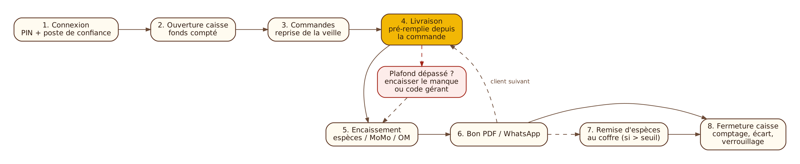
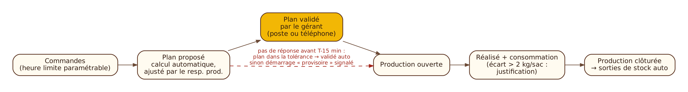
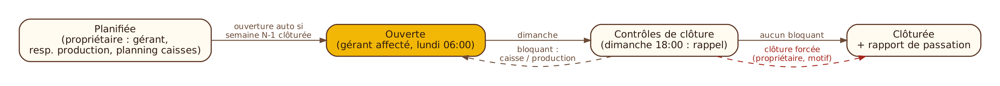

# OptiBoul ERP — Profils, parcours utilisateurs et UX

**Boulangerie du Faubourg · Etoudi, Yaoundé**  
Version 3 · 20 octobre 2026  
Préparé par Dongmo Noukouankouang Baudouin

> Remplace la version 2 du 14 octobre 2026. S'appuie sur le cahier des charges v5 du 20 octobre 2026 (optimisations O1 à O18) et le prototype cliquable mis à jour.

## Sommaire

- [1. Objet et nouveautés](#1-objet-et-nouveautés)
- [2. Profils](#2-profils)
- [3. Carte des parcours](#3-carte-des-parcours)
- [4. Parcours détaillés](#4-parcours-détaillés)
- [5. Principes UI/UX](#5-principes-uiux)
- [6. Objectifs d'expérience](#6-objectifs-dexpérience)
- [7. Points à valider](#7-points-à-valider)

## 1. Objet et nouveautés

Ce document décrit qui utilise OptiBoul ERP, comment chacun s'en sert au quotidien et les règles d'interface qui rendent la saisie rapide et sûre. La version 3 part du prototype cliquable du 20 octobre et du cahier des charges qui en découle, puis les **optimise** : chaque gain est repéré par sa référence O1 à O16, détaillée dans le cahier des charges v4.

| Ce qui ralentissait ou bloquait | Ce qui change dans les parcours | Réf. |
| --- | --- | --- |
| SMS de vérification à chaque connexion, impossible sans réseau | Code à 4 chiffres au comptoir, double authentification ciblée, codes hors ligne | O1 |
| Deux comptages : fermeture de caisse et clôture de session | Une seule fermeture de caisse par créneau | O2 |
| Quantités ressaisies entre commande et livraison | Livraison pré-remplie, « Livrer comme commandé » | O3 |
| Espèces accumulées toute la nuit | Remise au coffre proposée au-delà de 100 000 FCFA | O4 |
| Gérant obligé d'être au poste pour autoriser | Validation sur le téléphone, escalade au propriétaire | O5 |
| Pétrissage bloqué tant que le plan n'est pas validé | Validation automatique dans la tolérance, sinon démarrage provisoire signalé | O6 |
| Validation de chaque achat de bois ou de levure | Achats courants pré-autorisés pour la semaine | O7 |
| Lundi bloqué si la clôture du dimanche est oubliée | Rappel, ouverture automatique, clôture forcée motivée | O8 |
| Planning ressaisi chaque semaine | Copie de la semaine précédente et rotation proposée | O9 |
| Même écran d'accueil pour tous | Accueil selon le profil | O10 |
| Relance des clients habituels faite à la main au dernier moment | Rappel automatique 30 min avant l'heure limite, reprise de la commande habituelle | O18, O3 |
| Chaque sac de plus après validation attend le gérant | Petit supplément accordé automatiquement, gérant informé | O17 |
| Contrôle de stock long et influencé par le stock affiché | Contrôle guidé à l'aveugle, matières clés le mercredi | O13 |

## 2. Profils

### 2.1 Vue d'ensemble

| Profil (groupe) | Moment d'usage | Appareil | Accueil | Priorité UX |
| --- | --- | --- | --- | --- |
| Caissière (Caisse – nuit / jour) | Toute la session | PC du comptoir | Ma caisse | Vitesse, zéro calcul à la main |
| Gérant de la semaine (Gérants) | Plusieurs fois par jour, souvent à distance la nuit | PC + téléphone | Ma semaine | Tâches du jour, validations rapides |
| Responsable de production (Production) | Avant, pendant et après le pétrissage | PC, tablette plus tard | Plan du jour | Peu de champs, chiffres lisibles |
| Propriétaire (Direction) | Quotidien, à distance | Téléphone + PC | Tableau de bord | Lecture rapide, alertes, décisions |
| Administrateur (Support informatique) | Ponctuel | PC | Administration | Contrôle, sécurité, sauvegardes |

### 2.2 Caissière

| Élément | Détail |
| --- | --- |
| Exemples | Davy, Rachel · groupes Caisse – équipe de nuit / de jour |
| Contexte | Debout au comptoir, file de clients livreurs, souvent la nuit ; un seul PC partagé. Coupures possibles d'électricité et d'internet. |
| Objectifs | Servir un client en moins de 30 secondes. Fermer une caisse juste, sans recalcul. |
| Frustrations levées | Montants et restes calculés à la main dans Excel. Attente d'un SMS pour se connecter (O1), double comptage (O2), ressaisie des commandes (O3). |
| Ce qu'elle voit en arrivant | Ma caisse : caisse planifiée, bouton « Ouvrir la caisse », commandes de la session, clients au-delà du plafond. |

### 2.3 Gérant de la semaine

| Élément | Détail |
| --- | --- |
| Exemples | Willy, Patrick, Christelle · un gérant différent chaque lundi |
| Contexte | Passe au poste plusieurs fois par jour ; la nuit, il n'est pas toujours sur place. Rend compte au propriétaire et transmet au gérant suivant le dimanche. |
| Objectifs | Que rien ne bloque le comptoir ni l'atelier. Dettes réglées avant dimanche, passation propre. |
| Ce qu'il voit en arrivant | Ma semaine : tâches datées (valider le plan, payer la farine lundi, relancer les dettes, clôturer dimanche), demandes en attente, alertes. |

### 2.4 Responsable de production

| Élément | Détail |
| --- | --- |
| Exemples | Serge, Ignace · affecté à la semaine par le propriétaire |
| Contexte | Atelier, mains farinées : saisies courtes en début et fin de production. |
| Objectifs | Savoir combien de sacs pétrir par produit. Justifier les écarts de matières avant qu'ils deviennent des pertes. |
| Ce qu'il voit en arrivant | Plan du jour : commandes arrêtées, plan proposé, état de validation, chronomètre jusqu'au pétrissage. |

### 2.5 Propriétaire

| Élément | Détail |
| --- | --- |
| Exemple | Fotso (données de démonstration) |
| Contexte | Pilote à distance depuis son téléphone ; visites ponctuelles. |
| Objectifs | Savoir en un coup d'œil si la semaine et le mois sont rentables. Décider vite sur les demandes qui lui reviennent. |
| Ce qu'il voit en arrivant | Tableau de bord, demandes en attente, alertes cliquables, planning des semaines à venir. |

### 2.6 Administrateur et acteurs externes

| Acteur | Ce qu'il fait ou reçoit | Attente |
| --- | --- | --- |
| Administrateur | Comptes en 3 étapes, groupes, postes de confiance, sauvegardes, journal | Tout contrôler sans toucher aux données métier |
| Client livreur | Bon de livraison (écran, PDF, WhatsApp), relevé, relances jeudi et samedi | Vérifier ce qu'il doit avant dimanche |
| Fournisseur | Réceptions planifiées, factures, reçus de paiement | Être payé à temps, manquants suivis |

## 3. Carte des parcours

| N° | Parcours | Acteur principal | Fréquence | Durée cible |
| --- | --- | --- | --- | --- |
| P0 | Se connecter et changer d'utilisateur | Tous | Plusieurs fois par session | < 5 s au comptoir |
| P1 | Planifier une semaine | Propriétaire | Hebdomadaire | < 2 min |
| P2 | Prendre la semaine (lundi) | Gérant | Hebdomadaire | < 5 min |
| P3 | Tenir une caisse de bout en bout | Caissière | 2 fois par jour | Livraison < 30 s · fermeture < 5 min |
| P4 | Gérer un dépassement de plafond | Caissière + gérant | Quelques fois par session | < 1 min |
| P5 | Mener une production | Responsable de production + gérant | 2 fois par jour | Plan < 3 min · clôture < 5 min |
| P6 | Réceptionner et payer un fournisseur | Gérant | Hebdomadaire | Réception < 2 min |
| P7 | Saisir et faire valider une dépense | Caissière / gérant | Quotidien | < 1 min |
| P8 | Contrôler le stock et faire un inventaire | Gérant + responsable de production | Mercredi et dimanche, inventaire mensuel | Mercredi < 5 min · dimanche < 15 min |
| P9 | Préparer et payer la paie | Gérant + propriétaire | Mensuel | < 30 min |
| P10 | Clôturer la semaine et passer la main | Gérant | Hebdomadaire | < 10 min |
| P11 | Suivre et décider à distance | Propriétaire | Quotidien | Décision < 30 s |
| P12 | Créer un utilisateur, gérer sauvegardes | Administrateur | Ponctuel | Création < 2 min |
| P13 | Relancer les clients habituels | Caissière | 2 fois par jour | < 2 min |
| P14 | Augmenter la production | Responsable de production + gérant | Selon la demande | < 1 min |
| P15 | Tenir à jour une fiche technique | Propriétaire | Ponctuel | < 5 min |

## 4. Parcours détaillés

### P0 · Se connecter et changer d'utilisateur

| Élément | Détail |
| --- | --- |
| Déclencheur | Prise de poste ou changement de personne au comptoir |
| Résultat | Bonne personne connectée, avec ses droits et son accueil |
| Optimisations | O1, O10, O16 |

| Étape | Action de l'utilisateur | Réponse du logiciel | Optimisation / point UX |
| --- | --- | --- | --- |
| 1 | Touche son nom dans la liste des utilisateurs du poste | Affiche le pavé du code à 4 chiffres | Poste de confiance : pas de SMS pour la caissière (O1) |
| 2 | Tape son code | Vérifie dès le 4ᵉ chiffre et ouvre l'accueil du profil | Accueil selon le profil (O10) ; thème sombre la nuit (O16) |
| 3 | (Gérant, première connexion du jour) saisit le code reçu | Code à 6 chiffres par SMS ou WhatsApp ; sans réseau, code d'application ou de secours | La double authentification reste là où elle protège vraiment |
| 4 | Clique « Changer d'utilisateur » | Garde la saisie en brouillon, revient à la liste des noms | Aucune saisie perdue lors d'un changement |

*Exception : 5 codes faux bloquent le compte 15 minutes ; le gérant ou l'administrateur peut débloquer.*

### P1 · Planifier une semaine

| Élément | Détail |
| --- | --- |
| Déclencheur | Le propriétaire prépare les semaines à venir (au plus tard le vendredi) |
| Résultat | Semaine « Planifiée » avec gérant, responsable de production et une caissière par créneau |
| Optimisations | O9 |

| Étape | Action de l'utilisateur | Réponse du logiciel | Optimisation / point UX |
| --- | --- | --- | --- |
| 1 | Ouvre « Semaines » et choisit la semaine 43 | Affiche les affectations et le planning vides | — |
| 2 | Clique « Copier la semaine précédente » | Reprend le planning des caisses ; propose le prochain gérant et responsable selon la rotation | Planifier prend 2 min au lieu de 15 (O9) |
| 3 | Ajuste une affectation | Signale un conflit (même personne sur deux créneaux, congé) | Conflit visible avant validation |
| 4 | Valide | Semaine « Planifiée » ; gérant et responsable notifiés | — |

### P2 · Prendre la semaine (lundi)

| Élément | Détail |
| --- | --- |
| Déclencheur | Lundi 06:00 |
| Résultat | Semaine ouverte, gérant informé de tout ce qu'il reprend |
| Optimisations | O8, O7, O10 |

| Étape | Action de l'utilisateur | Réponse du logiciel | Optimisation / point UX |
| --- | --- | --- | --- |
| 1 | — | Ouvre automatiquement la semaine si la précédente est clôturée et les affectations faites | Pas d'action manuelle le lundi matin (O8) |
| 2 | Se connecte, arrive sur « Ma semaine » | Affiche le rapport de passation et la liste des tâches de la semaine | Les tâches viennent des règles (farine lundi, dettes dimanche) |
| 3 | Lit la passation | Dettes reportées, stock bas, incidents, demandes en attente | Tout ce qui est hérité est marqué « reporté » |
| 4 | Fixe les achats courants pré-autorisés | Propose les plafonds de la semaine précédente (bois, levure, glace…) | Plus de validation à chaque achat (O7) |

*Exception : si la semaine précédente n'est pas clôturée, le propriétaire reçoit l'alerte et peut forcer la clôture avec un motif.*

### P3 · Tenir une caisse de bout en bout

| Élément | Détail |
| --- | --- |
| Déclencheur | Début du créneau (18:00 nuit, 06:00 jour) |
| Résultat | Caisse fermée, juste, verrouillée ; bons remis à chaque client |
| Optimisations | O1, O2, O3, O4, O15 |

| Étape | Action de l'utilisateur | Réponse du logiciel | Optimisation / point UX |
| --- | --- | --- | --- |
| 1. Ouvrir | Clique « Ouvrir la caisse », compte le fonds | Propose 20 000 FCFA ; signale si elle n'est pas la caissière planifiée | Une seule caisse par créneau (O2) |
| 2. Commandes | Clique « Reprendre la veille », ajuste | Crée les commandes ; calcule les sacs à pétrir ; ferme la saisie à l'heure limite | Commandes des réguliers en 1 clic (O3) |
| 3. Livrer | Tape les premières lettres du client, Entrée | Pré-remplit les quantités commandées, calcule le montant dû et le solde après livraison | « Livrer comme commandé » en 1 touche (O3) |
| 4. Encaisser | Choisit le mode, saisit le montant reçu | Calcule le reste ; exige la référence mobile money ; met à jour le compte | Montant reçu proposé = montant dû |
| 5. Bon | Clique « Bon » ou « WhatsApp » | Affiche le PDF ; met l'envoi en file si hors ligne | Rien ne dépend du réseau (O15) |
| 6. Coffre | Accepte la proposition de remise | Au-delà de 100 000 FCFA d'espèces, enregistre la remise et le receveur | Moins d'argent exposé la nuit (O4) |
| 7. Dépense | Saisit une dépense de caisse, photo | La rattache à la caisse, à la production ou au stock ; pas de demande si pré-autorisée | Voir P7 |
| 8. Fermer | Compte les espèces, valide le récapitulatif | Calcule l'écart (fonds + espèces − dépenses − remises), verrouille, sauvegarde | Un seul comptage (O2) |

*Parcours P3 optimisé*

### P4 · Gérer un dépassement de plafond

| Élément | Détail |
| --- | --- |
| Déclencheur | La livraison ferait passer la dette au-delà de 2 000 FCFA |
| Résultat | Livraison encaissée, autorisée ou refusée, sans bloquer la file |
| Optimisations | O5, R19 |

| Étape | Action de l'utilisateur | Réponse du logiciel | Optimisation / point UX |
| --- | --- | --- | --- |
| 1 | Saisit les quantités | Bandeau rouge « Plafond dépassé » avec le montant manquant ; « Valider » désactivé | Le message dit toujours quoi faire |
| 2a | Encaisse le manque | Le bouton se réactive dès que le solde repasse sous le plafond | Solution la plus rapide en premier |
| 2b | Clique « Demander l'autorisation » | Crée DEM-xxx ; notifie le gérant sur son téléphone ; propose aussi le code gérant sur le poste | Le gérant absent peut répondre (O5) |
| 3 | Passe au client suivant | La livraison reste en attente dans la caisse | La file n'est pas bloquée |
| 4 | — | Accord : livraison validée, bon disponible. Refus : livraison annulée. Sans réponse en 10 min : demande au propriétaire | Escalade automatique (R19) |

### P5 · Mener une production

| Élément | Détail |
| --- | --- |
| Déclencheur | Heure limite des commandes (18:30 nuit, 05:30 jour) |
| Résultat | Production clôturée, sorties de stock créées, écarts justifiés |
| Optimisations | O6, O17 |

| Étape | Action de l'utilisateur | Réponse du logiciel | Optimisation / point UX |
| --- | --- | --- | --- |
| 1. Plan | Ouvre « Plan du jour » | Plan calculé : sacs, pains, boules par produit, avec ses trois sources (commandes, demande estimée, supplément) ; comparaison avec les 4 dernières sessions | Plan prêt sans calcul ; alerte si la demande estimée dépasse le plan |
| 2. Proposer | Ajuste si besoin, clique « Proposer » | Notifie le gérant (poste + téléphone) | — |
| 3. Valider | (Gérant) valide en un clic | Sans réponse à T-15 min : validé automatiquement si dans ± 10 %, sinon démarrage « provisoire » | Le pétrissage ne prend jamais de retard (O6) |
| 4. Ouvrir | Clique « Ouvrir la production » | Chronomètre ; rappelle les quantités par produit | Chiffres en très grand |
| 5. Réalisé | Saisit chaque fournée par produit | Met à jour le reste à produire, visible au comptoir et chez le gérant ; écart en pains et en % | La caisse sait ce qui reste à livrer |
| 6. Consommation | Saisit les matières utilisées | Affiche la valeur théorique à côté ; au-delà de 2 kg/sac, demande une justification | Motifs en liste + champ libre |
| 7. Clôturer | Valide | Crée les sorties de stock ; informe le gérant des écarts | Impossible sans 5 et 6 |

*Cycle de production optimisé*

### P6 · Réceptionner et payer un fournisseur

| Élément | Détail |
| --- | --- |
| Déclencheur | Arrivée d'une livraison planifiée ; lundi ou mardi pour la farine |
| Résultat | Stock à jour, facture et manquant suivis, fournisseur payé |
| Optimisations | O12 |

| Étape | Action de l'utilisateur | Réponse du logiciel | Optimisation / point UX |
| --- | --- | --- | --- |
| 1 | Ouvre la réception du jour dans « Fournisseurs » | Fiche pré-remplie : fournisseur, matière, quantité prévue | Réception en un clic (O12) |
| 2 | Saisit la quantité comptée, une observation | Crée l'entrée de stock et la facture (farine cumulée sur la semaine) | — |
| 3 | — | Si quantité < prévu : crée le manquant à livrer avec « Relancer » et « Replanifier » | Aucun manquant oublié |
| 4 | (Lundi) ouvre « Factures à payer » | Liste triée par échéance, farine de la semaine précédente en tête | Tâche visible dans « Ma semaine » |
| 5 | Paie (espèces, banque, mobile money) | Crée la dépense rattachée au stock et le reçu PDF | — |

### P7 · Saisir et faire valider une dépense

| Élément | Détail |
| --- | --- |
| Déclencheur | Achat au marché, facture, frais pendant une session |
| Résultat | Dépense DEP-xxxx rattachée, justifiée, validée si besoin |
| Optimisations | O7, O5 |

| Étape | Action de l'utilisateur | Réponse du logiciel | Optimisation / point UX |
| --- | --- | --- | --- |
| 1 | Clique « Nouvelle dépense » | Propose le rattachement selon le contexte (production en cours, semaine, stock) | Rattachement déduit, modifiable |
| 2 | Catégorie, libellé, montant, payé par, photo | Si achat de matière : quantité et fournisseur, crée l'entrée de stock | Photo prise avec la webcam ou le téléphone |
| 3 | Enregistre | Dans le cadre pré-autorisé : enregistrée. Sinon ≥ 50 000 FCFA : DEM-xxx au gérant ou au propriétaire | Moins de demandes (O7) |
| 4 | — | Statut de la dépense mis à jour à la décision ; budget recalculé | — |

### P8 · Contrôler le stock et faire un inventaire

| Élément | Détail |
| --- | --- |
| Déclencheur | Mercredi après la production de jour, dimanche à la clôture (rappel le jour même), fin de mois |
| Résultat | Contrôle « fait », stock ajusté, écarts expliqués ; un contrôle manqué remonte en alerte (R16) |
| Optimisations | O13 |

| Étape | Action de l'utilisateur | Réponse du logiciel | Optimisation / point UX |
| --- | --- | --- | --- |
| 1 | Ouvre le contrôle « à faire aujourd'hui » (gérant avec le responsable de production) | Liste pré-remplie : matières clés le mercredi, toutes le dimanche, toutes en fin de mois ; stock théorique masqué | Comptage à l'aveugle, plus honnête |
| 2 | Saisit les quantités comptées | Calcule l'écart par matière avec le stock à date | — |
| 3 | Valide | ≤ 5 % : ajusté. > 5 % : demande au propriétaire (AUD-xx), ajusté après accord ; statut « fait » | — |

### P9 · Préparer et payer la paie

| Élément | Détail |
| --- | --- |
| Déclencheur | Jour de paie − 3 jours (tâche dans « Ma semaine ») |
| Résultat | Paie validée et payée, impayés reportés |
| Optimisations | O14 |

| Étape | Action de l'utilisateur | Réponse du logiciel | Optimisation / point UX |
| --- | --- | --- | --- |
| 1 | Ouvre « Personnel », mois en cours | Brouillon pré-calculé : base, absences proposées depuis le planning, avances, impayés | Absences proposées (O14) |
| 2 | Confirme les absences, ajoute gains et pénalités motivés | Recalcule le net de chacun | — |
| 3 | Soumet | Demande au propriétaire | — |
| 4 | (Propriétaire) valide sur son téléphone | État « Validé » | — |
| 5 | Paie individuellement ou tous les restes | Crée les dépenses « Salaires », bulletins PDF, reporte les restes | Paiement partiel possible |

### P10 · Clôturer la semaine et passer la main

| Élément | Détail |
| --- | --- |
| Déclencheur | Dimanche 18:00 (rappel) |
| Résultat | Semaine clôturée, passation envoyée, semaine suivante prête |
| Optimisations | O8, O11, O13 |

| Étape | Action de l'utilisateur | Réponse du logiciel | Optimisation / point UX |
| --- | --- | --- | --- |
| 1 | Ouvre « Clôturer la semaine » | Contrôles : bloquants (caisse ouverte, production en cours) et à voir (dettes, factures, demandes, contrôle de stock) | Chaque contrôle ouvre l'écran qui le résout |
| 2 | Fait le contrôle de stock du dimanche | Voir P8 | — |
| 3 | Valide la clôture | Reporte les dettes non soldées, génère le rapport de passation, sauvegarde | — |
| 4 | — | Envoie la passation au gérant suivant ; la semaine suivante s'ouvrira lundi 06:00 | Enchaînement automatique (O8) |

*Cycle de vie de la semaine*

### P11 · Suivre et décider à distance

| Élément | Détail |
| --- | --- |
| Déclencheur | Notification d'une demande ou consultation quotidienne |
| Résultat | Décision prise, anomalies repérées |
| Optimisations | O5, O10 |

| Étape | Action de l'utilisateur | Réponse du logiciel | Optimisation / point UX |
| --- | --- | --- | --- |
| 1 | Ouvre la notification sur son téléphone | Connexion Google ou e-mail + double authentification | Accès distant toujours protégé |
| 2 | Lit la demande | Montant, émetteur, contexte (solde client, budget, historique) | Tout pour décider sur un écran |
| 3 | Accorde ou refuse (motif) | L'objet change de statut ; l'émetteur est notifié | Décision < 30 s |
| 4 | Parcourt le tableau de bord | Indicateurs, alertes cliquables jusqu'au détail | Une colonne sur téléphone |

### P12 · Administrer

| Élément | Détail |
| --- | --- |
| Déclencheur | Arrivée d'un employé, nouveau poste, contrôle des sauvegardes |
| Résultat | Compte actif avec les bons droits, données protégées |
| Optimisations | O1 |

| Étape | Action de l'utilisateur | Réponse du logiciel | Optimisation / point UX |
| --- | --- | --- | --- |
| 1 | Crée l'utilisateur : identité (Gmail, +237) | Contrôle e-mail unique et numéro à 9 chiffres commençant par 6 | Erreur affichée sous le champ |
| 2 | Choisit le groupe | Aperçu des accès du groupe | Pas de droits à la carte |
| 3 | Choisit le canal de vérification, envoie l'invitation | Invitation en file d'envoi ; codes de secours générés | Fonctionne hors ligne (O15) |
| 4 | Enregistre le poste du comptoir comme poste de confiance | Le poste accepte le code à 4 chiffres | O1 |
| 5 | Contrôle les sauvegardes | Dernières copies locale et cloud, restauration guidée | Alerte au-delà de 48 h |

### P13 · Relancer les clients habituels

| Élément | Détail |
| --- | --- |
| Déclencheur | 30 min avant l'heure limite des commandes (18:00 nuit, 05:00 jour) |
| Résultat | Commandes des habituels saisies avant l'heure limite |
| Optimisations | O18, O3, O15 |

| Étape | Action de l'utilisateur | Réponse du logiciel | Optimisation / point UX |
| --- | --- | --- | --- |
| 1 | — | Envoie automatiquement un rappel WhatsApp aux clients habituels sans commande (file d'envoi) | Relance sans action de la caissière (O18) |
| 2 | Voit la liste « Habituels sans commande » au-dessus des commandes | Affiche pour chacun sa commande habituelle et l'état du rappel (envoyé, lu, répondu) | — |
| 3 | Le client confirme par téléphone : clique « Reprendre l'habituelle » | Crée la commande, recalcule les sacs | Un clic (O3) |
| 4 | Relance encore un ou tous les clients restants | Nouveau message en file | — |
| 5 | Saisit une commande après la validation du plan | La signale au chef et au gérant comme commande tardive ; elle alimente le supplément (P14) | — |

### P14 · Augmenter la production

| Élément | Détail |
| --- | --- |
| Déclencheur | Demande estimée au-dessus du plan, commande tardive, marché ou événement |
| Résultat | Supplément intégré au plan et aux sorties de stock, sans retarder le pétrissage |
| Optimisations | O17, O5 |

| Étape | Action de l'utilisateur | Réponse du logiciel | Optimisation / point UX |
| --- | --- | --- | --- |
| 1 | Compare commandes, demande estimée et plan | Affiche l'écart par produit et le stock de farine disponible | Décision sur un écran |
| 2 | Ajoute des sacs par produit, choisit le motif | Motif obligatoire : clients habituels, guichet, marché ou événement, commande tardive | — |
| 3a | (Avant validation du plan) valide | Le supplément s'ajoute au plan proposé | — |
| 3b | (Après validation) valide | Supplément faible et farine suffisante : accordé automatiquement, gérant informé. Sinon demande DEM-xxx au gérant (poste ou téléphone) | Pas d'attente la nuit (O17) |
| 4 | — | Accordé : ajouté au plan, au reste à produire et aux sorties de stock ; chef et caisse notifiés | — |

### P15 · Tenir à jour une fiche technique

| Élément | Détail |
| --- | --- |
| Déclencheur | Nouveau prix d'une matière, changement de recette ou de rendement |
| Résultat | Coût de revient et marge à jour, ancienne version conservée |
| Optimisations | — |

| Étape | Action de l'utilisateur | Réponse du logiciel | Optimisation / point UX |
| --- | --- | --- | --- |
| 1 | Ouvre la fiche depuis le plan ou les paramètres | Ingrédients pour un sac de 50 kg, rendement, coût de revient par pain, marge, procédé | Accessible là où on en a besoin |
| 2 | Modifie une quantité, un rendement ou le procédé | Recalcule coût de revient et marge | Effet visible avant d'enregistrer |
| 3 | Enregistre | Crée une nouvelle version datée ; les plans déjà validés gardent leur version | Historique des versions tracé |

## 5. Principes UI/UX

### 5.1 Règles d'ergonomie

- **Le logiciel calcule, l'utilisateur vérifie** : montants, restes, soldes, écarts, nets de paie ne sont jamais saisis.
- **Pré-remplir plutôt que demander** : commande de la veille, quantité commandée, quantité prévue à la réception, rattachement de la dépense, absences proposées.
- **Clavier d'abord au comptoir** : Tab / Entrée, pavé numérique, raccourcis (F2 nouvelle livraison, F4 encaisser, F8 bon, Échap annuler).
- **Ne jamais bloquer sans issue** : chaque blocage affiche l'action possible à côté (encaisser le manque, demander, ouvrir l'écran qui résout).
- **Langage du métier** : caisse, session, BAG, KO, GC, ration, reste en salle, passation.
- **Montants lisibles** : FCFA sans décimale, espace des milliers, signe moins explicite ; chiffres à chasse fixe.
- **Cibles ≥ 44 px**, contraste AA, état jamais porté par la couleur seule.
- **Toujours savoir qui et où** : nom, profil, semaine, créneau et état en ligne visibles en permanence.

### 5.2 États du système

| Situation | Ce que voit l'utilisateur |
| --- | --- |
| Hors ligne | Pastille « Hors ligne – tout fonctionne », nombre d'envois en attente |
| Notifications | Cloche dans l'en-tête avec compteur de non-lues ; chaque notification ouvre l'écran concerné ; seuls les rôles concernés la reçoivent |
| Reste à produire | Bandeau par produit (prévu − réalisé) au comptoir, à l'atelier et chez le gérant, mis à jour à chaque fournée |
| Contrôle de stock du jour | Tâche « à faire aujourd'hui » en tête de « Ma semaine » et de « Plan du jour » ; « manqué » en rouge le lendemain |
| Envoi en file | Bon ou relance marqué « en attente d'envoi », puis « envoyé » |
| Demande en attente | Badge sur l'objet (livraison, dépense) et compte à rebours avant escalade |
| Production provisoire | Bandeau ambre « Plan non validé – démarrage provisoire » |
| Objet verrouillé | Bandeau « Fermé le … par … » ; champs en lecture seule ; « Rouvrir » pour les profils autorisés |
| Liste vide | Phrase qui dit quoi faire, avec le bouton correspondant |
| Erreur de saisie | Champ en rouge, correction attendue en une phrase |

### 5.3 Navigation

| Entrée du menu | Visible pour | Lot |
| --- | --- | --- |
| Accueil (selon le profil) | Tous | 1 |
| Ma caisse / Caisses | Caissière (ses caisses), gérant, propriétaire | 1 |
| Clients et dettes | Caissière (lecture), gérant, propriétaire | 1 |
| Production | Responsable de production, gérant, propriétaire | 1 |
| Stocks | Responsable de production, gérant, propriétaire | 2 |
| Fournisseurs et réceptions | Gérant, propriétaire | 1 (farine) · 2 |
| Dépenses et budget | Caissière (ses dépenses), gérant, propriétaire | 1 |
| Demandes | Tous (selon émetteur / valideur) | 1 |
| Personnel et paie | Gérant, propriétaire | 2 |
| Semaines et planning | Gérant, propriétaire | 1 |
| Tableau de bord | Gérant, propriétaire | 1 · 2 |
| Administration | Administrateur ; paramètres métier pour le propriétaire | 1 |

## 6. Objectifs d'expérience

| Mesure | Cible | Vérification |
| --- | --- | --- |
| Changer d'utilisateur au comptoir | < 5 s | Chronométrage en recette |
| Livraison + encaissement d'un client régulier | < 30 s | Semaine de test en parallèle de l'Excel |
| Fermeture de caisse, comptage compris | < 5 min | Observation |
| Décision du gérant sur une demande de plafond | < 2 min (médiane) | Journal des demandes |
| Retard de pétrissage dû au plan | 0 | Journal des productions |
| Écart de caisse non expliqué | 0 FCFA | Rapports de fermeture |
| Autonomie d'une caissière | Après une session accompagnée | Formation |

## 7. Points à valider

1. Liste des postes de confiance et profils autorisés au code à 4 chiffres.
2. Plafond d'espèces avant remise au coffre (100 000 FCFA proposé) et receveur (coffre ou gérant).
3. Tolérance de validation automatique du plan (± 10 %) et délai T-15 min.
4. Catégories et plafonds des achats pré-autorisés.
5. Jours et heures des relances automatiques (jeudi et samedi 10:00 proposés).
6. Raccourcis clavier du comptoir.
7. Seuil du supplément de production accordé automatiquement (≤ 1 sac par produit et ≤ 10 % du plan).
8. Heure du rappel automatique aux clients habituels (30 min avant l'heure limite).
9. Matières contrôlées le mercredi (farine, levure, améliorant proposés).