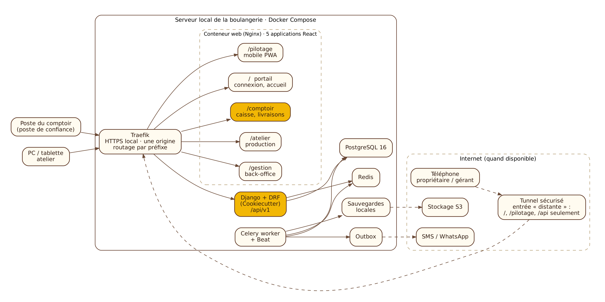
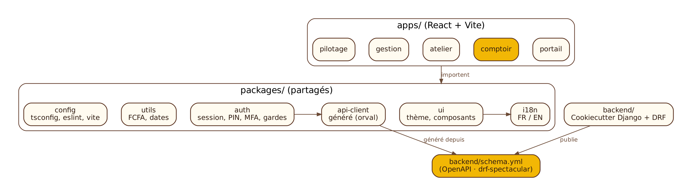
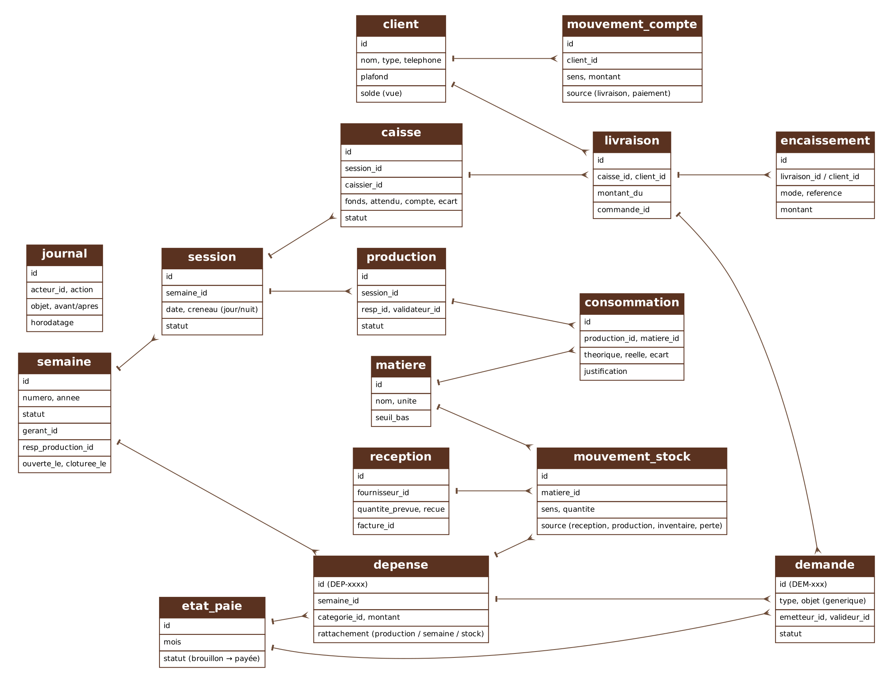

# OptiBoul ERP — Spécification technique et architecture

**Boulangerie du Faubourg · Etoudi, Yaoundé**  
Version 2 · 20 octobre 2026  
Préparé par Dongmo Noukouankouang Baudouin

> Monorepo · Python / Django REST Framework (Cookiecutter Django) · 5 applications web React + TypeScript (portail, comptoir, atelier, gestion, pilotage) · PostgreSQL 16. Met en œuvre le cahier des charges v4 et le backlog produit. Remplace la version 1 du 14 octobre 2026.

## Sommaire

- [1. Objet et principes d'architecture](#1-objet-et-principes-darchitecture)
- [2. Vue d'ensemble](#2-vue-densemble)
- [3. Monorepo](#3-monorepo)
- [4. Backend Django](#4-backend-django)
- [5. Base de données PostgreSQL](#5-base-de-données-postgresql)
- [6. API REST](#6-api-rest)
- [7. Authentification et sécurité](#7-authentification-et-sécurité)
- [8. Tâches planifiées, événements et file d'envoi](#8-tâches-planifiées-événements-et-file-denvoi)
- [9. Applications web React](#9-applications-web-react)
- [10. Déploiement et exploitation](#10-déploiement-et-exploitation)
- [11. Qualité, tests et intégration continue](#11-qualité-tests-et-intégration-continue)
- [12. Décisions d'architecture (ADR)](#12-décisions-darchitecture-adr)
- [13. Risques techniques](#13-risques-techniques)

## 1. Objet et principes d'architecture

Ce document décrit comment OptiBoul ERP est construit : un **monorepo unique** qui contient l'API **Django REST Framework** générée avec **Cookiecutter Django** et **cinq applications web React** (portail, comptoir, atelier, gestion, pilotage) partageant des paquets communs, sur une base **PostgreSQL 16**, le tout déployé sur un serveur local de la boulangerie. Il met en œuvre le cahier des charges v4 et le backlog produit.

| Version | Date | Changements |
| --- | --- | --- |
| 1 | 14 octobre 2026 | Architecture initiale : API Django REST et une seule interface React |
| 2 | 20 octobre 2026 | Monorepo Django REST (Cookiecutter) + plusieurs applications web React : découpage par usage (§9), espace de travail pnpm + Turborepo et paquets partagés (§3), routage par préfixe et exposition distante limitée (§2, §7), CI par application touchée (§11), nouvelles décisions ADR-09 à ADR-12 |

| Principe | Décision | Conséquence |
| --- | --- | --- |
| Local d'abord | Tout tourne sur le serveur local ; internet ne sert qu'aux envois, à la sauvegarde cloud et à l'accès distant | Le comptoir ne s'arrête jamais (R20) |
| Monolithe modulaire | Une seule API Django découpée en applications par domaine, sans microservices | Simple à installer et à maintenir sur un PC |
| Clean Architecture | Règles métier en Python pur (domaine), indépendantes de Django et de l'API | Règles testées à 90 % et plus, faciles à faire évoluer |
| Registre plutôt que solde | Comptes clients, stock et caisse sont des registres de mouvements ajoutés, jamais modifiés | Soldes toujours justifiables (R19), audit naturel |
| Transactions et file d'envoi | Chaque opération d'argent est une transaction ; tout envoi externe passe par une table outbox | Aucun SMS ou WhatsApp perdu, aucune écriture partielle |
| Sécurité par défaut | Droits vérifiés côté serveur, journal non modifiable, double authentification ciblée | Conforme R1, R13, R14 |

## 2. Vue d'ensemble



*Architecture d'ensemble : une API, cinq applications web, une seule origine*

| Composant | Technologie | Rôle |
| --- | --- | --- |
| Proxy | Traefik (fourni par Cookiecutter Django), deux points d'entrée : local et distant | HTTPS, routage par préfixe (/, /comptoir, /atelier, /gestion, /pilotage, /api), en-têtes de sécurité ; l'entrée distante n'expose que /, /pilotage et /api |
| Applications web | 5 applications React 19 + TypeScript + Vite, construites ensemble et servies par un conteneur Nginx | Chaque profil a son application adaptée à son poste (§9) |
| API | Django 5.2 LTS, DRF, Gunicorn | Règles métier, droits, endpoints REST |
| Tâches | Celery + Celery Beat, Redis | Planification (semaine, relances, escalades, plan auto), outbox, sauvegardes, PDF lourds |
| Base | PostgreSQL 16 | Données, contraintes, séquences de numérotation, déclencheurs d'audit |
| Sauvegarde | pg_dump + restic vers stockage S3 | Copies locales et cloud chiffrées |
| Envois | Passerelle SMS / WhatsApp Business (à choisir) | Codes, bons, relevés, relances, notifications |
| Accès distant | Cloudflare Tunnel ou Tailscale | Téléphone du propriétaire et du gérant, sans ouvrir de port |

## 3. Monorepo

Un seul dépôt Git porte le backend Django, toutes les applications web React, les paquets partagés, l'infrastructure et la documentation. Le backend est généré par Cookiecutter Django dans `backend/` ; les applications web vivent dans un espace de travail **pnpm** orchestré par **Turborepo** (`apps/` et `packages/`).



*Dépendances dans le monorepo : les applications importent les paquets ; le client API est généré depuis le schéma publié par Django*

### 3.1 Arborescence

```text
optiboul/
├── backend/                   # projet Cookiecutter Django + DRF
│   ├── config/                # settings, urls, celery
│   ├── optiboul/              # applications Django par domaine (§4)
│   ├── schema.yml             # OpenAPI publié (versionné)
│   └── requirements/  manage.py  pyproject.toml
├── apps/                      # applications web React + Vite
│   ├── portail/               # / : connexion, MFA, accueil par profil
│   ├── comptoir/              # /comptoir : caisse, livraisons
│   ├── atelier/               # /atelier : plan, production, inventaire
│   ├── gestion/               # /gestion : back-office gérant et propriétaire
│   └── pilotage/              # /pilotage : PWA mobile, demandes, alertes
├── packages/                  # code partagé entre applications
│   ├── ui/                    # thème OptiBoul, composants
│   ├── auth/                  # session, CSRF, PIN, MFA, gardes de profil
│   ├── api-client/            # client + hooks générés (orval)
│   ├── i18n/                  # catalogues FR / EN
│   ├── utils/                 # FCFA, dates Africa/Douala, raccourcis
│   ├── testing/               # mocks MSW, données de test
│   └── config/                # tsconfig, eslint, prettier, vite
├── e2e/                       # Playwright, parcours multi-applications
├── compose/                   # Dockerfiles : django, web, backup
├── infra/                     # installation, restic, tunnel
├── docs/                      # ADR, cahier des charges, guides
├── .github/workflows/         # CI
├── docker-compose.local.yml  docker-compose.production.yml
├── package.json  pnpm-workspace.yaml  turbo.json
└── Makefile                   # up, dev, test, lint, api-client
```

### 3.2 Outillage de l'espace de travail

| Sujet | Choix | Effet |
| --- | --- | --- |
| Gestionnaire de paquets | pnpm (espaces de travail), Node 22 LTS, versions figées par `packageManager` et `.nvmrc` | Une seule installation, dépendances dédupliquées |
| Orchestration | Turborepo : tâches `dev`, `build`, `lint`, `typecheck`, `test` avec cache | Seules les applications touchées sont reconstruites et testées |
| Python | Gestion des dépendances fournie par le gabarit Cookiecutter, dans `backend/` uniquement | Le backend reste un projet Cookiecutter standard, mis à jour comme tel |
| Contrat API | `backend/schema.yml` généré par drf-spectacular et versionné ; `packages/api-client` régénéré par `make api-client` | Toute rupture de contrat apparaît dans la revue de code et casse la CI |
| Règles d'import | Une application n'importe jamais une autre application ; elle passe par `packages/`. Contrôle par eslint (`no-restricted-imports`) | Applications indépendantes, code commun factorisé |
| Conventions | Commits conventionnels, CODEOWNERS par dossier (`backend/`, `apps/comptoir/`…), une version de produit pour tout le dépôt (étiquette `vAAAA.MM.n`) | Historique lisible, livraisons cohérentes |
| Développement local | `make up` lance Django, PostgreSQL, Redis, Celery (Docker) ; `pnpm dev` lance les 5 applications Vite avec un proxy `/api` vers Django | Même origine qu'en production : cookies et CSRF identiques |

### 3.3 Backend Cookiecutter Django

```text
backend/
├── config/                    # settings base/local/production/test
├── optiboul/
│   ├── users/                 # comptes, groupes, postes, MFA
│   ├── core/                  # semaines, planning, paramètres, journal
│   ├── caisse/                # caisses, remises, fermetures
│   ├── ventes/                # commandes, livraisons, encaissements
│   ├── clients/               # clients, tarifs, comptes, relances
│   ├── production/            # produits, fiches, plans, consommations
│   ├── stocks/                # matières, registre, inventaires
│   ├── achats/                # fournisseurs, réceptions, factures
│   ├── depenses/              # dépenses, budget, pré-autorisations
│   ├── demandes/              # validations, échéances, escalades
│   ├── paie/                  # employés, états de paie, paiements
│   ├── rapports/              # tableau de bord, PDF, Excel
│   └── notifications/         # outbox, SMS, WhatsApp, in-app
└── requirements/  manage.py  pyproject.toml  schema.yml
```

| Option Cookiecutter Django | Valeur | Pourquoi |
| --- | --- | --- |
| use_drf | y | API REST |
| use_docker | y | Même environnement en développement et sur le serveur local |
| use_celery | y | Tâches planifiées et outbox |
| postgresql_version | 16 | Version retenue |
| frontend_pipeline | None | Les interfaces sont les applications React de `apps/`, hors de Django |
| cloud_provider | None | Fichiers servis localement ; sauvegarde cloud gérée par restic |
| use_mailpit | y | E-mails de test en local |
| use_sentry | n | Pas de dépendance réseau ; journaux locaux (option ultérieure) |
| use_async / use_heroku | n | Inutile ici |
| keep_local_envs_in_vcs | n | Secrets hors du dépôt |

## 4. Backend Django

### 4.1 Couches de la Clean Architecture

Chaque application suit quatre couches. La règle de dépendance est stricte : `domain` ne dépend de rien, `application` dépend du domaine, `infrastructure` et `api` dépendent des deux. Un test d'architecture (import-linter) fait échouer la CI si la règle est violée.

| Couche | Contenu | Exemple (application caisse / ventes) |
| --- | --- | --- |
| domain/ | Entités, objets valeur (Montant, Quantite), règles, erreurs métier | `peut_livrer(solde, montant, plafond)` ; `ecart_caisse(fonds, especes, depenses, remises)` |
| application/ | Cas d'usage transactionnels, ports (interfaces) vers les dépôts et services | `EnregistrerLivraison`, `FermerCaisse`, `DemanderAutorisation` |
| infrastructure/ | Modèles Django, dépôts, PDF (WeasyPrint), tâches Celery, adaptateurs SMS | `CaisseModel`, `LivraisonRepository`, `generer_bon_pdf` |
| api/ | Serializers, vues, routes DRF, permissions | `POST /api/v1/livraisons/`, `POST /api/v1/caisses/{id}/fermer/` |

```python
# optiboul/ventes/domain/regles.py  (Python pur, sans Django)
@dataclass(frozen=True)
class ResultatPlafond:
    autorise: bool
    manque: int  # FCFA à encaisser pour repasser sous le plafond

def verifier_plafond(solde_avant: int, montant_du: int,
                     recu: int, plafond: int) -> ResultatPlafond:
    solde_apres = solde_avant + recu - montant_du  # dette < 0
    manque = max(0, -solde_apres - plafond)
    return ResultatPlafond(autorise=manque == 0, manque=manque)
```

### 4.2 Règles transverses

- **Montants** en entiers (FCFA), jamais en flottants ; quantités en `Decimal` à 3 décimales.
- **Transactions** : chaque cas d'usage s'exécute dans `transaction.atomic()` ; verrouillage `select_for_update()` sur la caisse et le compte client pendant une livraison.
- **Idempotence** : en-tête `Idempotency-Key` sur les POST d'argent ; un double clic ou une reprise réseau ne crée jamais deux livraisons.
- **États** : semaine, caisse, production, demande, paie et facture ont des machines à états explicites ; toute transition passe par un cas d'usage qui vérifie les préconditions (R2 à R5).
- **Numérotation** : DEP-xxxx, DEM-xxx, AUD-xx, factures et reçus via des séquences PostgreSQL, sans trou ni doublon.
- **Rattachement** : `semaine_id` et `auteur_id` obligatoires sur toute opération (R1), renseignés par le cas d'usage, jamais par le client.
- **Paramètres** : table `parametre` versionnée, lue via un service mis en cache Redis et invalidé à chaque modification.

### 4.3 Droits

Les droits combinent le **profil du groupe** (groupes et permissions Django) et l'**affectation de la semaine** (gérant ou responsable de production de la semaine en cours). Chaque vue DRF déclare une classe de permission métier, testée pour les cinq profils.

| Mécanisme | Usage |
| --- | --- |
| Groupe Django → profil | Caissier, Gérant, Production, Propriétaire, Administrateur ; permissions par fonction (matrice §3.3 du CdC) |
| Affectation de semaine | `EstGerantDeLaSemaine`, `EstResponsableProductionDeLaSemaine` : droits ajoutés pendant la semaine affectée seulement |
| Propriété de l'objet | Une caissière ne lit que ses caisses, dépenses et demandes (filtrage des querysets) |
| Code gérant sur le poste | Autorisation ponctuelle : le gérant saisit son code, l'action est signée de son identité sans changer d'utilisateur |

## 5. Base de données PostgreSQL

### 5.1 Choix de conception

| Sujet | Proposition |
| --- | --- |
| Version et encodage | PostgreSQL 16, UTF-8, fuseau `Africa/Douala`, horodatages `timestamptz` |
| Clés | `bigint` identité en clé primaire ; numéros métier (DEP-xxxx…) en colonne unique séparée |
| Argent | `bigint` en FCFA ; contraintes `CHECK (montant >= 0)` et sens porté par une colonne |
| Quantités | `numeric(12,3)` avec unité portée par la matière |
| Registres | Tables append-only `mouvement_compte`, `mouvement_stock`, `mouvement_caisse` ; soldes par vues (et colonne de cache mise à jour dans la même transaction, contrôlée chaque nuit) |
| Unicité métier | Index uniques partiels : une seule semaine ouverte ; une caisse par session ; une production par session |
| Journal | Table `journal` en ajout seul, protégée par un déclencheur qui refuse UPDATE et DELETE ; partitionnée par année |
| Historique | django-simple-history sur les référentiels (clients, tarifs, produits, paramètres) |
| Recherche client | Index trigramme (`pg_trgm`) sur le nom pour la recherche par premières lettres |
| Rôles base | Rôle applicatif sans droit DDL ; rôle de migration séparé ; rôle lecture seule pour la sauvegarde |

### 5.2 Modèle de données



*Entités principales et relations (simplifié)*

| Domaine | Tables |
| --- | --- |
| users | utilisateur, groupe, profil_droit, poste_confiance, code_pin, facteur_mfa, code_verification, code_secours, connexion |
| core | semaine, affectation_semaine, creneau_planning, session, parametre, journal, sequence_numero |
| caisse | caisse, mouvement_caisse (encaissement espèces, dépense, remise coffre), fermeture |
| ventes | commande, ligne_commande, livraison, ligne_livraison, encaissement, mouvement_interne |
| clients | client, tarif_client, mouvement_compte, relance |
| production | produit, fiche_technique, ligne_recette, plan_production, ligne_plan, production, ligne_production, consommation |
| stocks | matiere, mouvement_stock, inventaire, ligne_inventaire |
| achats | fournisseur, matiere_fournisseur, reception_planifiee, reception, manquant, facture_fournisseur, paiement_fournisseur |
| depenses | categorie_depense, budget_mensuel, pre_autorisation, depense, piece_jointe |
| demandes | demande (objet générique : type + identifiant), decision |
| paie | employe, etat_paie, ligne_paie, element_paie (gain / pénalité / absence / avance), paiement_salaire |
| notifications | outbox_message, notification, modele_message |

### 5.3 Extraits de schéma

```sql
CREATE TABLE semaine (
  id bigint GENERATED ALWAYS AS IDENTITY PRIMARY KEY,
  annee smallint NOT NULL, numero smallint NOT NULL,
  debut timestamptz NOT NULL, fin timestamptz NOT NULL,
  statut text NOT NULL
    CHECK (statut IN ('PLANIFIEE','OUVERTE','CLOTUREE')),
  gerant_id bigint REFERENCES utilisateur(id),
  resp_production_id bigint REFERENCES utilisateur(id),
  cloture_forcee_motif text,
  UNIQUE (annee, numero)
);
CREATE UNIQUE INDEX une_semaine_ouverte ON semaine ((true))
  WHERE statut = 'OUVERTE';

CREATE TABLE caisse (
  id bigint GENERATED ALWAYS AS IDENTITY PRIMARY KEY,
  session_id bigint NOT NULL UNIQUE REFERENCES session(id), -- R15
  caissier_id bigint NOT NULL REFERENCES utilisateur(id),
  fonds bigint NOT NULL CHECK (fonds >= 0),
  attendu bigint, compte bigint, ecart bigint,
  statut text NOT NULL
    CHECK (statut IN ('OUVERTE','FERMEE','ROUVERTE')),
  ouverte_le timestamptz NOT NULL DEFAULT now(),
  fermee_le timestamptz
);

CREATE TABLE mouvement_compte (   -- registre client, ajout seul
  id bigint GENERATED ALWAYS AS IDENTITY PRIMARY KEY,
  client_id bigint NOT NULL REFERENCES client(id),
  semaine_id bigint NOT NULL REFERENCES semaine(id),
  sens smallint NOT NULL CHECK (sens IN (-1, 1)), -- -1 = livraison
  montant bigint NOT NULL CHECK (montant > 0),
  source_type text NOT NULL, source_id bigint NOT NULL,
  auteur_id bigint NOT NULL REFERENCES utilisateur(id),
  cree_le timestamptz NOT NULL DEFAULT now()
);
CREATE VIEW v_solde_client AS
  SELECT client_id, SUM(sens * montant) AS solde
  FROM mouvement_compte GROUP BY client_id;

CREATE TABLE journal (
  id bigint GENERATED ALWAYS AS IDENTITY,
  horodatage timestamptz NOT NULL DEFAULT now(),
  acteur_id bigint, profil text, poste_id bigint, action text NOT NULL,
  objet_type text, objet_id bigint, avant jsonb, apres jsonb,
  PRIMARY KEY (id, horodatage)
) PARTITION BY RANGE (horodatage);
CREATE FUNCTION journal_immuable() RETURNS trigger LANGUAGE plpgsql AS
  $$ BEGIN RAISE EXCEPTION 'journal en ajout seul'; END $$;
CREATE TRIGGER journal_no_update BEFORE UPDATE OR DELETE ON journal
  FOR EACH ROW EXECUTE FUNCTION journal_immuable();
```

*Les tables sont créées par les migrations Django ; contraintes, index partiels, vues et déclencheurs sont ajoutés par des migrations `RunSQL` versionnées.*

## 6. API REST

### 6.1 Conventions

- Préfixe `/api/v1/`, JSON, noms en français cohérents avec le métier ; documentation OpenAPI 3 générée par drf-spectacular (`/api/v1/schema/`).
- Pagination par curseur sur les registres, par page sur les listes ; filtres django-filter (`?semaine=42&statut=OUVERTE`).
- Erreurs au format RFC 9457 (Problem Details) avec un code métier : `PLAFOND_DEPASSE`, `CAISSE_FERMEE`, `SEMAINE_NON_CLOTUREE`…
- Actions métier explicites en `POST /{ressource}/{id}/{action}/` ; jamais de changement d'état par un simple PATCH.
- `Idempotency-Key` obligatoire sur livraisons, encaissements, dépenses, paiements.

### 6.2 Ressources principales

| Ressource | Actions métier | Règles |
| --- | --- | --- |
| /auth/ | login-pin, login, verify-otp, totp, logout, switch-user, trusted-devices | R14, O1 |
| /semaines/ | planifier, copier-precedente, ouvrir, controles-cloture, cloturer, cloturer-forcee, passation | R2, R3, R18 |
| /caisses/ | ouvrir, remise-coffre, fermer, rouvrir | R13, R15, R16 |
| /commandes/ | reprendre-veille ; plan des sacs | O3 |
| /livraisons/ | livrer-comme-commande, bon (pdf), envoyer-whatsapp | R6, R7 |
| /encaissements/ | — | R7, R19 |
| /clients/ | releve, relancer, relancer-groupe ; /clients/dettes/ | R6, O11 |
| /demandes/ | accorder, refuser ; /demandes/en-attente/ | R17, O5 |
| /productions/ | plan, proposer, valider, ouvrir, realise, consommation, cloturer | R4, R5, R10 |
| /stocks/ | etat, mouvements, pertes ; /inventaires/ : valider | R9 |
| /fournisseurs/, /receptions/, /factures/ | receptionner, relancer-manquant, replanifier, payer | R11 |
| /depenses/, /budgets/, /pre-autorisations/ | justificatif | R8, O7 |
| /paie/ | preparer, soumettre, valider, payer, bulletins | R12 |
| /tableau-de-bord/, /rapports/ | session, semaine, mois, export | — |
| /admin/ | utilisateurs, groupes, parametres, journal, sauvegardes, restaurer | — |

## 7. Authentification et sécurité

| Besoin | Mise en œuvre |
| --- | --- |
| Comptes, e-mail + mot de passe, Google | django-allauth (fourni par Cookiecutter) avec le fournisseur Google ; seuls les Gmail enregistrés sont acceptés |
| Code à 4 chiffres au comptoir | Code haché en Argon2, accepté uniquement avec un jeton de **poste de confiance** (cookie signé HttpOnly + enregistrement en base, révocable) |
| Code SMS / WhatsApp | Code à 6 chiffres haché, valable 5 min, 3 essais ; envoi par l'outbox ; renvoi après 30 s |
| Sans réseau | TOTP et codes de secours via le module MFA de django-allauth |
| Sessions | Cookie de session HttpOnly, Secure, SameSite=Strict ; CSRF ; expiration d'inactivité paramétrable |
| Force brute | Limitation par compte et par poste (5 échecs → 15 min), journalisée |
| Transport | HTTPS partout ; certificat local (mkcert) sur le réseau de la boulangerie, certificat du tunnel à distance |
| Exposition distante | Entrée Traefik « distante » dédiée au tunnel : seuls /, /pilotage et /api y sont routés ; comptoir, atelier, gestion et l'admin Django restent inaccessibles hors du réseau local ; l'API refuse les connexions par code à 4 chiffres venant de cette entrée |
| Origine des requêtes | Chaque application envoie un en-tête `X-OptiBoul-App` enregistré dans le journal ; certaines actions sont limitées à une application (ex. fermeture de caisse depuis comptoir uniquement) |
| Secrets | Variables d'environnement hors dépôt ; clé de chiffrement des sauvegardes conservée hors serveur |
| Données personnelles | Téléphones masqués à l'affichage ; accès au journal réservé au propriétaire et à l'administrateur |

## 8. Tâches planifiées, événements et file d'envoi

| Tâche (Celery Beat) | Quand | Effet |
| --- | --- | --- |
| ouvrir_semaine | Lundi 06:00 | Ouvre la semaine si prête, sinon alerte au propriétaire (O8) |
| rappel_cloture_semaine | Dimanche 18:00 | Notification au gérant |
| valider_plan_auto | Toutes les minutes | À T-15 min du pétrissage : validation automatique dans la tolérance ou statut provisoire (O6) |
| escalader_demandes | Toutes les minutes | Demandes échues remontées au propriétaire (R17) |
| relances_dettes | Jeudi et samedi 10:00 | Relances WhatsApp des dettes à régler avant dimanche (O11) |
| archiver_productions | Ouverture de session | Productions non clôturées archivées et signalées |
| sauvegarde_locale | Toutes les 4 h + clôtures | pg_dump vers le disque de sauvegarde |
| sauvegarde_cloud | Toutes les heures si réseau | restic chiffré vers S3 ; alerte au-delà de 48 h |
| dispatcher_outbox | Toutes les 30 s | Envoie les messages en attente, délai croissant après échec (O15) |
| controle_registres | Chaque nuit 03:00 | Compare soldes en cache et registres ; alerte en cas d'écart |

**Outbox** : un cas d'usage qui doit envoyer un SMS, un WhatsApp ou une notification écrit une ligne `outbox_message` dans la même transaction que l'opération. Le dispatcher la lit, l'envoie quand le réseau est là et met à jour son statut. L'opération du comptoir ne dépend donc jamais du réseau.

## 9. Applications web React

Au lieu d'une seule interface, chaque usage a **son application** : plus légère, adaptée à son poste et à ses utilisateurs, déployable et testable séparément. Toutes appellent la même API Django et partagent thème, authentification et client API via `packages/`.

### 9.1 Les cinq applications

| Application | Préfixe | Utilisateurs | Poste | Contenu | Exposée à distance |
| --- | --- | --- | --- | --- | --- |
| portail | / | Tous | Tous | Connexion (e-mail, Google, double authentification, TOTP), choix de la langue et du thème, redirection vers l'application du profil (O10) | Oui |
| comptoir | /comptoir | Caissières, gérant | PC du comptoir (poste de confiance) | Connexion nom + code à 4 chiffres, ouverture et fermeture de caisse, commandes, livraisons, encaissements, mouvements internes, remises au coffre, dépenses de caisse, demandes de plafond | Non |
| atelier | /atelier | Responsable de production, gérant | PC ou tablette de l'atelier | Plan du jour, validation, production ouverte, réalisé, consommation, justification des écarts, inventaire tournant ; gros boutons, saisie tactile | Non |
| gestion | /gestion | Gérant, propriétaire, administrateur | PC | Semaines et planning, clients et dettes, fournisseurs et réceptions, stocks, dépenses et budget, paie, demandes, tableau de bord, rapports, administration | Non (local) |
| pilotage | /pilotage | Propriétaire, gérant | Téléphone | PWA installable : demandes à valider, alertes, indicateurs du jour et du mois, notifications | Oui (tunnel) |

*Le back-office gestion reste local ; le propriétaire et le gérant décident à distance depuis pilotage. Si l'accès distant à gestion devient nécessaire, il suffit d'ajouter son préfixe à l'entrée distante de Traefik.*

### 9.2 Socle commun

| Sujet | Choix |
| --- | --- |
| Langage et outils | React 19, TypeScript strict (JavaScript typé), Vite ; une configuration Vite de base dans `packages/config`, chaque application fixe son `base` (`/comptoir/`…) |
| Routage et données | React Router dans chaque application ; TanStack Query (cache, reprise) ; pas de mutation optimiste sur les écrans d'argent |
| Client API | `packages/api-client` généré depuis `backend/schema.yml` (orval) : types et hooks identiques dans toutes les applications |
| Authentification | `packages/auth` : session par cookie de même origine, jeton CSRF, gardes par profil ; une session ouverte dans le portail est valable dans toutes les applications |
| Composants | `packages/ui` : Mantine avec le thème OptiBoul (or, chocolat, crème, Manrope), clair et sombre, composants métier (MontantFCFA, PaveNumerique, BadgeEtat, BandeauHorsLigne, CarteDemande) |
| Formulaires | React Hook Form + Zod |
| Langues | `packages/i18n` (react-i18next), FR par défaut et EN ; formats via Intl (fr-CM, FCFA sans décimale) |
| Navigation entre applications | Liens simples entre préfixes (même origine) ; le menu ne propose que les applications autorisées pour le profil |

### 9.3 Spécificités par application

| Application | Points techniques |
| --- | --- |
| comptoir | Gestionnaire de raccourcis clavier (F2, F4, F8, Échap) et ordre de tabulation testé.<br>Brouillons de saisie en IndexedDB (changement d'utilisateur, coupure).<br>Refus de démarrer sans jeton de poste de confiance ; thème sombre la nuit (O16).<br>Service worker : interface disponible pendant un redémarrage du serveur. |
| atelier | Mise en page tactile (cibles ≥ 56 px), chiffres très grands.<br>Chronomètre de production, rappel des valeurs théoriques à côté des champs. |
| gestion | Tableaux denses avec filtres, exports Excel et PDF, graphiques (Recharts).<br>Écrans d'administration réservés au profil administrateur. |
| pilotage | PWA installable (vite-plugin-pwa), interface une colonne.<br>Notifications Web Push quand le tunnel est disponible, sinon actualisation à l'ouverture.<br>Double authentification exigée à chaque connexion distante. |
| portail | Très léger : formulaires de connexion et de vérification, redirection selon le profil. |

### 9.4 Tests

- Vitest + Testing Library dans chaque application et chaque paquet ; mocks MSW générés depuis le schéma OpenAPI (`packages/testing`).
- Playwright dans `e2e/` sur l'environnement Docker complet : P3 au clavier (comptoir), P4 (comptoir + pilotage), P5 (atelier + pilotage), P10 (gestion).

## 10. Déploiement et exploitation

### 10.1 Matériel

| Élément | Recommandation |
| --- | --- |
| Serveur | PC du comptoir si ≥ 16 Go de mémoire et SSD ; sinon mini-PC dédié (Linux, 16 Go, SSD 512 Go) relié au poste par le réseau local |
| Alimentation | Onduleur pour le serveur et le routeur, relais par le groupe électrogène |
| Sauvegarde | Disque externe dédié + stockage S3 |
| Réseau | Routeur local ; internet pour envois, cloud et tunnel |

### 10.2 Services Docker Compose (production)

| Service | Image | Redémarrage |
| --- | --- | --- |
| traefik | Traefik (Cookiecutter) | always |
| django | Image du backend, Gunicorn | always |
| web | Nginx contenant les 5 builds React (une image construite par Turborepo, un dossier par préfixe) | always |
| postgres | PostgreSQL 16 (Cookiecutter) | always |
| redis | Redis 7 | always |
| celeryworker / celerybeat | Image du backend | always |
| backup | Image restic + scripts de sauvegarde | always |
| tunnel | cloudflared ou tailscale | always |

### 10.3 Installation, mises à jour, restauration

- **Installation** : script `infra/install` qui vérifie le matériel, installe Docker, crée les secrets, lance les services, applique les migrations, importe l'Excel et crée les comptes.
- **Mises à jour** : images versionnées ; sauvegarde automatique avant migration ; retour arrière vers l'image et la sauvegarde précédentes.
- **Restauration** : commande guidée depuis la copie locale ou cloud ; testée avant la mise en service puis chaque mois.
- **Surveillance** : contrôles de santé des services, journaux centralisés en local, tableau « Santé du système » pour l'administrateur (dernière sauvegarde, file d'envoi, espace disque).

## 11. Qualité, tests et intégration continue

| Niveau | Outils | Cible |
| --- | --- | --- |
| Règles du domaine | pytest, Hypothesis (tests de propriétés sur plafond, écarts, paie) | Couverture ≥ 90 % |
| Cas d'usage et API | pytest-django, factory_boy, client DRF | Chaque règle R1–R20 et chaque profil de droits |
| Base | Tests des contraintes, index partiels et déclencheurs | Toutes les contraintes métier |
| Interface | Vitest, Testing Library | Composants de saisie et calculs affichés |
| Parcours | Playwright | P3 (au clavier), P4, P5, P10 |
| Performance | Locust sur le poste de référence | API < 300 ms au 95ᵉ centile |
| Qualité du code | Ruff, mypy, import-linter, ESLint, Prettier, pre-commit | CI bloquante |

### Intégration continue (GitHub Actions)

| Étape | Déclenchée quand | Contenu |
| --- | --- | --- |
| Backend | `backend/` modifié | Ruff, mypy, import-linter, pytest avec PostgreSQL 16 de service, couverture du domaine ≥ 90 % |
| Contrat API | `backend/` modifié | Régénère `schema.yml` et `packages/api-client` ; échec s'ils diffèrent de ce qui est commité |
| Applications et paquets | Toujours, filtré par Turborepo (`--filter=...[origin/main]`) | lint, typecheck, test et build des seules applications et paquets touchés, avec cache distant |
| Bout en bout | Pull request vers la branche principale | Docker Compose complet, Playwright sur les parcours P3, P4, P5, P10 |
| Livraison | Étiquette `vAAAA.MM.n` | Images `optiboul-backend` et `optiboul-web` versionnées ensemble, publiées dans le registre |

## 12. Décisions d'architecture (ADR)

| N° | Décision | Alternative écartée | Raison |
| --- | --- | --- | --- |
| ADR-01 | Monolithe modulaire Django | Microservices | Un seul serveur local, petite équipe |
| ADR-02 | Serveur local + tunnel | Hébergement cloud | Le comptoir doit fonctionner sans internet |
| ADR-03 | PostgreSQL 16 | SQLite | Transactions concurrentes, contraintes partielles, déclencheurs, sauvegarde à chaud |
| ADR-04 | Registres append-only | Soldes modifiés en place | Traçabilité et justification de chaque solde |
| ADR-05 | Outbox transactionnelle | Envoi direct depuis la vue | Aucun envoi perdu hors ligne |
| ADR-06 | Sessions + cookies | Jetons JWT dans le navigateur | Même origine, révocation simple, moins de surface d'attaque |
| ADR-07 | Code à 4 chiffres lié au poste de confiance | SMS à chaque connexion | Rapidité au comptoir, fonctionnement hors ligne |
| ADR-08 | Client API généré (orval) | Client écrit à la main | Pas de divergence entre API et interface |
| ADR-09 | Monorepo unique : backend Cookiecutter Django + applications React | Un dépôt par composant | Un changement d'API et ses écrans dans la même revue ; une seule version livrée |
| ADR-10 | Cinq applications React par usage | Une seule application pour tous | Comptoir léger et rapide, atelier tactile, pilotage mobile ; exposition distante limitée à ce qui est utile |
| ADR-11 | Même origine, routage par préfixe | Un sous-domaine par application | Session et CSRF partagés sans configuration CORS ; certificat local unique |
| ADR-12 | pnpm + Turborepo, paquets partagés | Code copié entre applications | Thème, auth et client API écrits une fois ; builds et tests limités aux parties touchées |

## 13. Risques techniques

| Risque | Parade |
| --- | --- |
| Panne du serveur local | Onduleur, sauvegardes 4 h + cloud, restauration testée, image prête sur un second PC |
| Passerelle SMS / WhatsApp indisponible ou coûteuse | Outbox, TOTP et codes de secours, bascule de canal |
| Horloge du serveur décalée | Synchronisation NTP ; heures métier calculées côté serveur dans le fuseau Africa/Douala |
| Croissance du journal | Partitionnement annuel, archivage des partitions de plus de 5 ans |
| Montée de version Django ou React | Versions LTS, mises à jour trimestrielles testées en CI ; une seule version de React pour toutes les applications (catalogue pnpm) |
| Applications qui divergent | Règles d'import, paquets partagés, revue CODEOWNERS sur `packages/` |
| Durée de build du monorepo | Cache Turborepo, builds filtrés, une seule image web |
