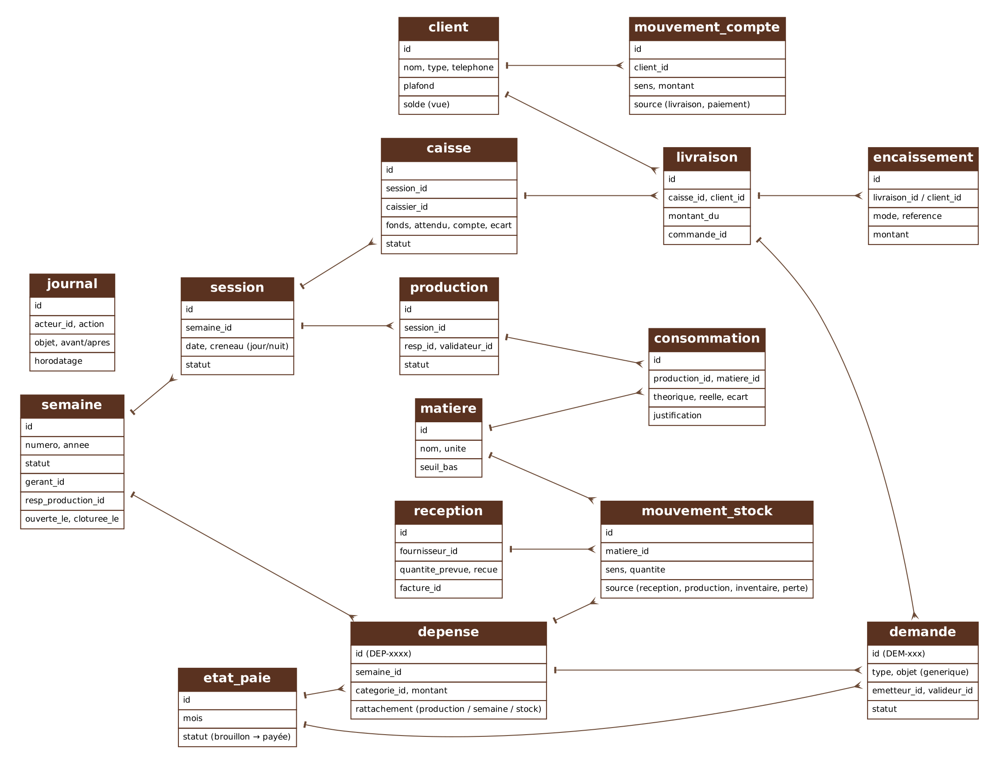

# OptiBoul ERP — Spécification technique et architecture

**Boulangerie du Faubourg · Etoudi, Yaoundé**  
Version 4 · 28 octobre 2026  
Préparé par Dongmo Noukouankouang Baudouin

> Monorepo · deux applications autonomes : `apps/api` (Python / Django REST Framework, Cookiecutter Django) et `apps/web` (une seule application React + TypeScript, à espaces selon le profil) · PostgreSQL 16. Met en œuvre le cahier des charges v5 et le backlog produit v2, complété par les récits US-153 à US-171. Remplace la version 3 du 20 octobre 2026.

## Sommaire

- [1. Objet et principes d'architecture](#1-objet-et-principes-darchitecture)
- [2. Vue d'ensemble](#2-vue-densemble)
- [3. Monorepo](#3-monorepo)
- [4. API Django](#4-api-django)
- [5. Base de données PostgreSQL](#5-base-de-données-postgresql)
- [6. API REST](#6-api-rest)
- [7. Authentification et sécurité](#7-authentification-et-sécurité)
- [8. Tâches planifiées, événements et file d'envoi](#8-tâches-planifiées-événements-et-file-denvoi)
- [9. Application web React](#9-application-web-react)
- [10. Déploiement et exploitation](#10-déploiement-et-exploitation)
- [11. Qualité, tests et intégration continue](#11-qualité-tests-et-intégration-continue)
- [12. Décisions d'architecture (ADR)](#12-décisions-darchitecture-adr)
- [13. Risques techniques](#13-risques-techniques)

## 1. Objet et principes d'architecture

Ce document décrit comment OptiBoul ERP est construit : un **monorepo** qui contient deux applications autonomes, l'API **Django REST Framework** générée avec **Cookiecutter Django** (`apps/api`) et **une seule application web React** (`apps/web`) dont les espaces dépendent du profil de l'utilisateur, sur une base **PostgreSQL 16**, le tout déployé sur un serveur local de la boulangerie. Il met en œuvre le cahier des charges v5, le backlog produit v2 et les récits ajoutés depuis dans les issues GitHub (US-153 à US-171).

| Version | Date | Changements |
| --- | --- | --- |
| 1 | 14 octobre 2026 | Architecture initiale : API Django REST et une seule interface React |
| 2 | 20 octobre 2026 | Monorepo Django REST (Cookiecutter) + plusieurs applications web React, espace de travail pnpm + Turborepo et paquets partagés, routage par préfixe, ADR-09 à ADR-12 |
| 3 | 20 octobre 2026 | Alignement sur le cahier des charges v5 : demande estimée et supplément de production, reste à produire, fiches techniques versionnées, stock à date, contrôles de stock bi-hebdomadaires, centre de notifications ciblé ; règles R15–R22 |
| 4 | 28 octobre 2026 | Alignement sur les ADR-14 à ADR-20 et les issues : `apps/api` + `apps/web` autonomes (§3), **une seule application web à espaces** au lieu de cinq (§9), plus d'application `pilotage` ni de PWA mobile séparée, accès distant par l'application web (§2, §7), Django 6.0 / Node 24 / oxlint (§3), AWS S3 et Mailgun (§10), sécurité issue de l'audit du 22 octobre (§7, §10), mode simulation et contrôle visuel (§9, §11), CI réelle (§11) ; la décision « rafraîchissement court » devient ADR-21 |

| Principe | Décision | Conséquence |
| --- | --- | --- |
| Local d'abord | Tout tourne sur le serveur local ; internet ne sert qu'aux envois, à la sauvegarde cloud et à l'accès distant | Le comptoir ne s'arrête jamais (R20, R22) |
| Monolithe modulaire | Une seule API Django découpée en applications par domaine, sans microservices | Simple à installer et à maintenir sur un PC |
| Clean Architecture | Règles métier en Python pur (domaine), indépendantes de Django et de l'API | Règles testées à 90 % et plus, faciles à faire évoluer |
| Registre plutôt que solde | Comptes clients, stock et caisse sont des registres de mouvements ajoutés, jamais modifiés | Soldes toujours justifiables (R21), audit naturel |
| Transactions et file d'envoi | Chaque opération d'argent est une transaction ; tout envoi externe passe par une table outbox | Aucun SMS ou WhatsApp perdu, aucune écriture partielle |
| Un seul client | Une seule application web ; le profil décide de ce que l'utilisateur voit, l'API de ce qu'il peut faire | Un build, une image, une URL à tester |
| Sécurité par défaut | Droits vérifiés côté serveur, journal non modifiable, double authentification ciblée | Conforme R1, R13, R14 |

## 2. Vue d'ensemble

```text
        Réseau local de la boulangerie                       Internet
 ┌───────────────────────────────────────┐        ┌──────────────────────────┐
 │ PC du comptoir · atelier · gestion    │        │ Téléphone du propriétaire│
 │ (navigateur)                          │        │ et du gérant             │
 └──────────────┬────────────────────────┘        └────────────┬─────────────┘
                │ HTTPS (mkcert)                               │ Cloudflare Tunnel
                ▼                                              ▼
 ┌──────────────────────────────────────────────────────────────────────────┐
 │ Traefik · entrée locale :443                 entrée distante :8443       │
 │  /api /accounts /static /django-admin → django   /api /accounts /static  │
 │  tout le reste                         → web     → django ; reste → web  │
 └──────────────┬──────────────────────────────────────┬────────────────────┘
                ▼                                      ▼
   web (Nginx, apps/web)                   django (Gunicorn, apps/api)
                                           ├── PostgreSQL 16
                                           ├── Redis ── Celery worker / beat
                                           └── S3 (médias, sauvegardes) · Mailgun · SMS / WhatsApp
```

| Composant | Technologie | Rôle |
| --- | --- | --- |
| Proxy | Traefik (fourni par Cookiecutter Django), deux points d'entrée : local et distant | HTTPS, routage par préfixe, en-têtes de sécurité ; l'entrée distante n'expose ni l'admin Django ni Flower |
| Application web | Une application React 19 + TypeScript + Vite, servie par un conteneur Nginx | Espaces connexion, comptoir, atelier, gestion selon le profil (§9) |
| API | Django 6.0, DRF, Gunicorn | Règles métier, droits, endpoints REST |
| Tâches | Celery + Celery Beat, Redis | Planification (semaine, relances, escalades, plan auto), outbox, sauvegardes, PDF lourds |
| Base | PostgreSQL 16 | Données, contraintes, séquences de numérotation, déclencheurs d'audit |
| Stockage et e-mails | AWS S3 (médias, copies de sauvegarde), Mailgun (django-anymail) | ADR-14 |
| Envois | Passerelle SMS / WhatsApp Business (à choisir), via l'outbox | Codes, bons, relevés, relances, notifications sur téléphone |
| Accès distant | Cloudflare Tunnel (service `tunnel`, profil Compose `distant`) | Téléphone du propriétaire et du gérant, sans ouvrir de port |

En production, Traefik sert une **seule origine** : la session et le jeton CSRF sont partagés sans configuration CORS.

## 3. Monorepo

Un seul dépôt Git porte les deux applications, l'infrastructure et la documentation. Chaque application est **autonome** : elle a ses dépendances, ses outils, ses tests et son image Docker (ADR-17, ADR-20). La racine ne contient que ce qui est commun.

### 3.1 Arborescence

```text
optiboul/
├── apps/
│   ├── api/                  # API Django REST (Cookiecutter) : Django 6, DRF, Celery, PostgreSQL 16
│   │   ├── config/           # settings base/local/production/test, urls, api_router, celery
│   │   ├── optiboul/         # 12 applications par domaine + users, 4 couches chacune (§4)
│   │   ├── compose/          # Dockerfiles django, postgres, traefik, aws
│   │   ├── .envs/            # variables d'environnement (exemples versionnés, secrets hors dépôt)
│   │   ├── docker-compose.local.yml  docker-compose.production.yml
│   │   ├── schema.yml        # contrat OpenAPI publié (versionné)
│   │   └── pyproject.toml  uv.lock  manage.py
│   └── web/                  # application web unique : React + Vite + TypeScript (pnpm)
│       ├── src/
│       │   ├── profils.ts    # profil → espaces visibles et écran d'arrivée (O10)
│       │   ├── navigation.ts # écrans de chaque espace et profils qui les voient
│       │   ├── espaces/      # connexion, comptoir, atelier, gestion, clients
│       │   ├── mise-en-page/ # coque : menu, en-tête, gardes
│       │   ├── api/          # client + hooks TanStack Query générés (orval) depuis apps/api/schema.yml
│       │   ├── auth/         # utilisateur connecté, profil, CSRF
│       │   ├── ui/           # thème OptiBoul (Mantine), composants métier
│       │   ├── i18n/         # FR / EN
│       │   ├── utils/        # FCFA, créneaux jour / nuit, couleurs
│       │   ├── simulation/   # faux serveur du mode simulation (exclu du build de production)
│       │   └── test/         # mocks MSW, setup Vitest
│       ├── e2e/              # parcours Playwright, banc de contrôle visuel (e2e/visuel)
│       ├── Dockerfile  nginx.conf
│       └── package.json  pnpm-lock.yaml  vite.config.ts  orval.config.ts
├── docs/                     # spécifications, design, ADR
├── infra/                    # installation, certificats, tunnel
├── scripts/github/           # import du backlog en issues et tableau de projet
├── .github/workflows/        # ci.yml, e2e.yml
├── docker-compose.production.yml   # inclut celui de apps/api + web + tunnel
├── .pre-commit-config.yaml
└── Makefile                  # install, up, dev, migrate, test, lint, api-client, e2e, prod-build
```

### 3.2 Outillage

| Sujet | Choix | Effet |
| --- | --- | --- |
| Python | Python 3.14, **uv**, dans `apps/api` uniquement ; Ruff, mypy, import-linter | L'API reste un projet Cookiecutter standard, mis à jour comme tel (ADR-15) |
| Web | Node.js 24 LTS (`apps/web/.nvmrc`), **pnpm 12** (`packageManager`), dans `apps/web` uniquement ; oxlint, TypeScript 7, Prettier | Pas d'espace de travail pnpm ni de Turborepo à la racine (ADR-16, ADR-20) |
| Contrat API | `apps/api/schema.yml` généré par drf-spectacular et versionné ; `apps/web/src/api/generated/` régénéré par `make api-client` (orval) | Toute rupture de contrat apparaît dans la revue de code et casse la CI |
| Règles d'import | API : `domain` ← `application` ← `infrastructure` / `api`, contrôlé par import-linter. Web : alias `@/` vers `src/`, un espace n'importe pas le code d'un autre espace | Couches et espaces indépendants |
| Conventions | Commits conventionnels, une branche par récit issue de `develop`, pull request vers `develop` avec `Closes #n`, jamais de push direct sur `main` ni `develop` | Historique lisible, lien récit ↔ code |
| Développement local | `make up` lance Django, PostgreSQL, Redis, Celery, Mailpit, Flower (Docker) ; `make dev` lance Vite sur :5173 avec un proxy vers Django :8000 ; `pnpm dev:simulation` lance l'application sans backend (§9.5) | Même origine qu'en production : cookies et CSRF identiques |

### 3.3 API Cookiecutter Django

```text
apps/api/optiboul/
├── users/                 # comptes, groupes et profils (ProfilGroupe), postes, MFA
├── core/                  # semaines, planning, paramètres, journal, santé
├── caisse/                # caisses, remises, fermetures
├── ventes/                # commandes, livraisons, encaissements
├── clients/               # clients, tarifs, comptes, relances
├── production/            # produits, fiches, plans, consommations
├── stocks/                # matières, registre, inventaires
├── achats/                # fournisseurs, réceptions, factures
├── depenses/              # dépenses, budget, pré-autorisations
├── demandes/              # validations, échéances, escalades
├── paie/                  # employés, états de paie, paiements
├── rapports/              # tableau de bord, PDF, Excel
└── notifications/         # outbox, SMS, WhatsApp, in-app
```

Chaque domaine expose ses routes dans `optiboul/<domaine>/api/urls.py`, assemblées sous `/api/v1/` par `config/api_router.py`.

| Option Cookiecutter Django | Valeur | Pourquoi |
| --- | --- | --- |
| use_drf | y | API REST |
| use_docker | y | Même environnement en développement et sur le serveur local |
| use_celery | y | Tâches planifiées et outbox |
| postgresql_version | 16 | Version retenue |
| frontend_pipeline | None | L'interface est `apps/web`, hors de Django |
| cloud_provider | AWS | Médias et copies de sauvegarde sur S3 (ADR-14) |
| mail_service | Mailgun | E-mails via django-anymail (ADR-14) |
| use_whitenoise | y | Fichiers statiques servis localement, même sans internet |
| use_mailpit | y | E-mails de test en local |
| use_sentry | n | Pas de dépendance réseau côté API ; suivi d'erreurs du navigateur prévu (US-162) |
| use_async / use_heroku | n | Inutile ici |
| keep_local_envs_in_vcs | n | Secrets hors du dépôt ; seuls les `.example` sont versionnés |

Adaptations au gabarit (ADR-15) : API sous `/api/v1/` ; authentification par session seule (ADR-06), sans `rest_framework.authtoken` ; `LANGUAGE_CODE = "fr"`, fuseau `Africa/Douala` ; cookie CSRF lisible par l'application web.

## 4. API Django

### 4.1 Couches de la Clean Architecture

Chaque application suit quatre couches. La règle de dépendance est stricte : `domain` ne dépend de rien, `application` dépend du domaine, `infrastructure` et `api` dépendent des deux. Un test d'architecture (import-linter) fait échouer la CI si la règle est violée.

| Couche | Contenu | Exemple (application caisse / ventes) |
| --- | --- | --- |
| domain/ | Entités, objets valeur (Montant, Quantite), règles, erreurs métier | `peut_livrer(solde, montant, plafond)` ; `ecart_caisse(fonds, especes, depenses, remises)` |
| application/ | Cas d'usage transactionnels, ports (interfaces) vers les dépôts et services | `EnregistrerLivraison`, `FermerCaisse`, `DemanderAutorisation` |
| infrastructure/ | Modèles Django, dépôts, PDF (WeasyPrint), tâches Celery, adaptateurs SMS | `CaisseModel`, `LivraisonRepository`, `generer_bon_pdf` |
| api/ | Serializers, vues, routes DRF, permissions | `POST /api/v1/livraisons/`, `POST /api/v1/caisses/{id}/fermer/` |

```python
# optiboul/ventes/domain/regles.py  (Python pur, sans Django)
@dataclass(frozen=True)
class ResultatPlafond:
    autorise: bool
    manque: int  # FCFA à encaisser pour repasser sous le plafond

def verifier_plafond(solde_avant: int, montant_du: int,
                     recu: int, plafond: int) -> ResultatPlafond:
    solde_apres = solde_avant + recu - montant_du  # dette < 0
    manque = max(0, -solde_apres - plafond)
    return ResultatPlafond(autorise=manque == 0, manque=manque)
```

### 4.2 Règles transverses

- **Montants** en entiers (FCFA), jamais en flottants ; quantités en `Decimal` à 3 décimales.
- **Transactions** : chaque cas d'usage s'exécute dans `transaction.atomic()` ; verrouillage `select_for_update()` sur la caisse et le compte client pendant une livraison.
- **Idempotence** : en-tête `Idempotency-Key` sur les POST d'argent ; un double clic, une reprise réseau ou le rejeu de la file d'envoi du navigateur (US-161) ne crée jamais deux livraisons.
- **États** : semaine, caisse, production, demande, paie et facture ont des machines à états explicites ; toute transition passe par un cas d'usage qui vérifie les préconditions (R2 à R5).
- **Numérotation** : DEP-xxxx, DEM-xxx, AUD-xx, factures et reçus via des séquences PostgreSQL, sans trou ni doublon.
- **Rattachement** : `semaine_id` et `auteur_id` obligatoires sur toute opération (R1), renseignés par le cas d'usage, jamais par le client.
- **Paramètres** : table `parametre` versionnée, lue via un service mis en cache Redis et invalidé à chaque modification.

### 4.3 Droits

Les droits combinent le **profil du groupe** et l'**affectation de la semaine** (gérant ou responsable de production de la semaine en cours). Chaque vue DRF déclare une classe de permission métier, testée pour chaque profil.

| Mécanisme | Usage |
| --- | --- |
| Groupe Django → profil | Chaque groupe porte un profil de droits (modèle `ProfilGroupe`, CdC §3.2) : caissier, production, gérant, propriétaire, administrateur. L'administrateur configure les groupes ; les groupes de départ du cahier des charges sont créés par migration. `GET /api/v1/users/me/` renvoie le `profil` (ADR-18) |
| Affectation de semaine | `EstGerantDeLaSemaine`, `EstResponsableProductionDeLaSemaine` : droits ajoutés pendant la semaine affectée seulement |
| Propriété de l'objet | Une caissière ne lit que ses caisses, dépenses et demandes (filtrage des querysets) |
| Code gérant sur le poste | Autorisation ponctuelle : le gérant saisit son code, l'action est signée de son identité sans changer d'utilisateur |
| Entrée distante | Requête portant `X-OptiBoul-Entree: distante` : double authentification exigée, code à 4 chiffres refusé (§7) |

L'application web ne fait qu'**afficher** selon le profil (`profils.ts`, `navigation.ts`) ; chaque droit reste vérifié par l'API.

## 5. Base de données PostgreSQL

### 5.1 Choix de conception

| Sujet | Proposition |
| --- | --- |
| Version et encodage | PostgreSQL 16, UTF-8, fuseau `Africa/Douala`, horodatages `timestamptz` |
| Clés | `bigint` identité en clé primaire ; numéros métier (DEP-xxxx…) en colonne unique séparée |
| Argent | `bigint` en FCFA ; contraintes `CHECK (montant >= 0)` et sens porté par une colonne |
| Quantités | `numeric(12,3)` avec unité portée par la matière |
| Registres | Tables append-only `mouvement_compte`, `mouvement_stock`, `mouvement_caisse` ; soldes par vues (et colonne de cache mise à jour dans la même transaction, contrôlée chaque nuit) |
| Unicité métier | Index uniques partiels : une seule semaine ouverte ; une caisse par session ; une production par session ; un seul inventaire en attente |
| Journal | Table `journal` en ajout seul, protégée par un déclencheur qui refuse UPDATE et DELETE ; partitionnée par année |
| Historique | django-simple-history sur les référentiels (clients, tarifs, produits, paramètres) |
| Recherche client | Index trigramme (`pg_trgm`) sur le nom pour la recherche par premières lettres |
| Rôles base | Rôle applicatif sans droit DDL ; rôle de migration séparé ; rôle lecture seule pour la sauvegarde |

### 5.2 Modèle de données



*Entités principales et relations (simplifié)*

| Domaine | Tables |
| --- | --- |
| users | utilisateur, groupe, profil_groupe, poste_confiance, code_pin, facteur_mfa, code_verification, code_secours, connexion |
| core | semaine, affectation_semaine, creneau_planning, session, parametre, journal, sequence_numero |
| caisse | caisse, mouvement_caisse (encaissement espèces, dépense, remise coffre), fermeture |
| ventes | commande, ligne_commande, livraison, ligne_livraison, encaissement, mouvement_interne |
| clients | client, tarif_client, mouvement_compte, relance, habitude_client (commande habituelle par session, recalculée chaque nuit) |
| production | produit, fiche_technique (versionnée : rendement, coût de revient, marge, procédé), ligne_recette, plan_production (garde la version de fiche), ligne_plan (commandes, demande estimée, supplément), supplement_production (motif, statut, demande liée), production, fournee, consommation ; vue v_reste_a_produire |
| stocks | matiere, prix_matiere (historisé), mouvement_stock, controle_stock (mercredi / dimanche, statut prévu / à faire / fait / manqué), ligne_controle, inventaire, ligne_inventaire ; fonction stock_a_date(date) |
| achats | fournisseur, matiere_fournisseur, reception_planifiee, reception, manquant, facture_fournisseur, paiement_fournisseur |
| depenses | categorie_depense, budget_mensuel, pre_autorisation, depense, piece_jointe |
| demandes | demande (objet générique : type + identifiant), decision |
| paie | employe, etat_paie, ligne_paie, element_paie (gain / pénalité / absence / avance), paiement_salaire |
| notifications | outbox_message, notification (destinataire, lue_le, lien), regle_notification (type → rôles destinataires, canaux), modele_message |

### 5.3 Extraits de schéma

```sql
CREATE TABLE semaine (
  id bigint GENERATED ALWAYS AS IDENTITY PRIMARY KEY,
  annee smallint NOT NULL, numero smallint NOT NULL,
  debut timestamptz NOT NULL, fin timestamptz NOT NULL,
  statut text NOT NULL
    CHECK (statut IN ('PLANIFIEE','OUVERTE','CLOTUREE')),
  gerant_id bigint REFERENCES utilisateur(id),
  resp_production_id bigint REFERENCES utilisateur(id),
  cloture_forcee_motif text,
  UNIQUE (annee, numero)
);
CREATE UNIQUE INDEX une_semaine_ouverte ON semaine ((true))
  WHERE statut = 'OUVERTE';

CREATE TABLE caisse (
  id bigint GENERATED ALWAYS AS IDENTITY PRIMARY KEY,
  session_id bigint NOT NULL UNIQUE REFERENCES session(id), -- R17
  caissier_id bigint NOT NULL REFERENCES utilisateur(id),
  fonds bigint NOT NULL CHECK (fonds >= 0),
  attendu bigint, compte bigint, ecart bigint,
  statut text NOT NULL
    CHECK (statut IN ('OUVERTE','FERMEE','ROUVERTE')),
  ouverte_le timestamptz NOT NULL DEFAULT now(),
  fermee_le timestamptz
);

CREATE TABLE mouvement_compte (   -- registre client, ajout seul
  id bigint GENERATED ALWAYS AS IDENTITY PRIMARY KEY,
  client_id bigint NOT NULL REFERENCES client(id),
  semaine_id bigint NOT NULL REFERENCES semaine(id),
  sens smallint NOT NULL CHECK (sens IN (-1, 1)), -- -1 = livraison
  montant bigint NOT NULL CHECK (montant > 0),
  source_type text NOT NULL, source_id bigint NOT NULL,
  auteur_id bigint NOT NULL REFERENCES utilisateur(id),
  cree_le timestamptz NOT NULL DEFAULT now()
);
CREATE VIEW v_solde_client AS
  SELECT client_id, SUM(sens * montant) AS solde
  FROM mouvement_compte GROUP BY client_id;

CREATE TABLE journal (
  id bigint GENERATED ALWAYS AS IDENTITY,
  horodatage timestamptz NOT NULL DEFAULT now(),
  acteur_id bigint, profil text, poste_id bigint, entree text,
  action text NOT NULL,
  objet_type text, objet_id bigint, avant jsonb, apres jsonb,
  PRIMARY KEY (id, horodatage)
) PARTITION BY RANGE (horodatage);
CREATE FUNCTION journal_immuable() RETURNS trigger LANGUAGE plpgsql AS
  $$ BEGIN RAISE EXCEPTION 'journal en ajout seul'; END $$;
CREATE TRIGGER journal_no_update BEFORE UPDATE OR DELETE ON journal
  FOR EACH ROW EXECUTE FUNCTION journal_immuable();

CREATE TABLE controle_stock (            -- R16 : mercredi et dimanche
  id bigint GENERATED ALWAYS AS IDENTITY PRIMARY KEY,
  semaine_id bigint NOT NULL REFERENCES semaine(id),
  jour date NOT NULL,
  portee text NOT NULL CHECK (portee IN ('CLES','TOUTES')),
  statut text NOT NULL
    CHECK (statut IN ('PREVU','A_FAIRE','FAIT','MANQUE')),
  gerant_id bigint REFERENCES utilisateur(id),
  resp_production_id bigint REFERENCES utilisateur(id),
  UNIQUE (semaine_id, jour)
);

CREATE TABLE supplement_production (     -- R15, O17
  id bigint GENERATED ALWAYS AS IDENTITY PRIMARY KEY,
  plan_id bigint NOT NULL REFERENCES plan_production(id),
  produit_id bigint NOT NULL REFERENCES produit(id),
  sacs numeric(6,2) NOT NULL CHECK (sacs > 0),
  motif text NOT NULL CHECK (motif IN
    ('HABITUELS','GUICHET','MARCHE_EVENEMENT','COMMANDE_TARDIVE')),
  apres_validation boolean NOT NULL,
  statut text NOT NULL
    CHECK (statut IN ('AJOUTE','AUTO_ACCORDE','DEMANDE','ACCORDE','REFUSE')),
  demande_id bigint REFERENCES demande(id)
);
```

*Les tables sont créées par les migrations Django ; contraintes, index partiels, vues et déclencheurs sont ajoutés par des migrations `RunSQL` versionnées. La colonne `entree` du journal (locale / distante) remplace l'en-tête par application de la version 3.*

## 6. API REST

### 6.1 Conventions

- Préfixe `/api/v1/`, JSON, noms en français cohérents avec le métier ; schéma OpenAPI 3 généré par drf-spectacular (`/api/v1/schema/`), documentation interactive sur `/api/v1/docs/` (compte administrateur).
- Pagination par curseur sur les registres, par page sur les listes ; filtres django-filter (`?semaine=42&statut=OUVERTE`).
- Erreurs au format RFC 9457 (Problem Details) avec un code métier : `PLAFOND_DEPASSE`, `CAISSE_FERMEE`, `SEMAINE_NON_CLOTUREE`…
- Actions métier explicites en `POST /{ressource}/{id}/{action}/` ; jamais de changement d'état par un simple PATCH.
- `Idempotency-Key` obligatoire sur livraisons, encaissements, dépenses, paiements.
- Toute réponse est du JSON, y compris les erreurs : l'application web traite une réponse non JSON (page d'erreur d'un proxy) comme une panne (US-153).

### 6.2 Ressources principales

| Ressource | Actions métier | Règles |
| --- | --- | --- |
| /sante/ | état du serveur, utilisé par l'application web pour l'indicateur réseau (pas `navigator.onLine`) | R20, US-161 |
| /users/me/ | utilisateur connecté et son `profil` | ADR-18 |
| /auth/ | login-pin, login, verify-otp, totp, logout, switch-user, trusted-devices | R14, O1 |
| /semaines/ | planifier, copier-precedente, ouvrir, controles-cloture, cloturer, cloturer-forcee, passation | R2, R3, R20 |
| /caisses/ | ouvrir, remise-coffre, fermer, rouvrir | R13, R17, R18 |
| /commandes/ | reprendre-habituelle, habituels-sans-commande, relancer-habituels ; plan des sacs ; commande tardive signalée | O3, O18 |
| /livraisons/ | livrer-comme-commande, bon (pdf), envoyer-whatsapp | R6, R7 |
| /encaissements/ | — | R7, R21 |
| /clients/ | releve, relancer, relancer-groupe ; /clients/dettes/ | R6, O11 |
| /demandes/ | accorder, refuser ; /demandes/en-attente/ | R19, O5 |
| /productions/ | plan (3 sources), demande-estimee, proposer, valider, supplement, ouvrir, fournee, reste-a-produire, consommation, cloturer | R4, R5, R10, R15, O17 |
| /fiches-techniques/ | versions, nouvelle-version, cout-de-revient | — |
| /stocks/ | etat, stock-a-date?date=, mouvements, pertes ; /controles-stock/ : commencer, valider ; /inventaires/ : valider | R9, R16 |
| /notifications/ | non-lues (compteur), marquer-lue, tout-marquer-lu | — |
| /fournisseurs/, /receptions/, /factures/ | receptionner, relancer-manquant, replanifier, payer | R11 |
| /depenses/, /budgets/, /pre-autorisations/ | justificatif | R8, O7 |
| /paie/ | preparer, soumettre, valider, payer, bulletins | R12 |
| /tableau-de-bord/, /rapports/ | session, semaine, mois, export | — |
| /admin/ | utilisateurs, groupes, parametres, journal, sauvegardes, restaurer | — |

Tant qu'une ressource n'est pas livrée, l'écran correspondant est construit sur le mode simulation (§9.5) avec le même contrat.

## 7. Authentification et sécurité

| Besoin | Mise en œuvre |
| --- | --- |
| Comptes, e-mail + mot de passe, Google | django-allauth (fourni par Cookiecutter) avec le fournisseur Google ; seuls les Gmail enregistrés sont acceptés |
| Code à 4 chiffres au comptoir | Code haché en Argon2, accepté uniquement avec un jeton de **poste de confiance** (cookie signé HttpOnly + enregistrement en base, révocable) |
| Code SMS / WhatsApp | Code à 6 chiffres haché, valable 5 min, 3 essais ; envoi par l'outbox ; renvoi après 30 s |
| Sans réseau | TOTP et codes de secours via le module MFA de django-allauth |
| Sessions | Cookie de session HttpOnly, Secure, SameSite=Strict ; durée et inactivité adaptées au poste partagé (`SESSION_COOKIE_AGE`, US-156) ; CSRF : cookie `__Secure-csrftoken` en production, lu par l'application web sous ce nom et sous son nom local (US-153) |
| Force brute | Limitation par compte et par poste (throttling DRF, `ACCOUNT_RATE_LIMITS` d'allauth), verrouillage temporaire après plusieurs codes faux et déblocage par l'administrateur, règle `rateLimit` de Traefik sur `/accounts` et `/api/v1` ; chaque échec et verrouillage journalisé (US-155) |
| Transport | HTTPS partout ; certificat local (mkcert, `make certs`) sur le réseau de la boulangerie, certificat du tunnel à distance ; HSTS cohérent entre Django et Traefik (US-156) |
| Exposition distante | Entrée Traefik « distante » (:8443) dédiée au tunnel : elle expose l'application web, `/api`, `/accounts` et `/static` ; l'admin Django et Flower restent inaccessibles de l'extérieur (ADR-19). `forwardedHeaders` de confiance sur cette entrée ; `CSRF_TRUSTED_ORIGINS` renseigné |
| Origine des requêtes | Traefik pose `X-OptiBoul-Entree: distante` sur les requêtes du tunnel : l'API exige alors la double authentification à chaque connexion et refuse le code à 4 chiffres (CdC §4.1, R14 ; US-156). L'entrée est enregistrée dans le journal |
| Application web | Conteneur Nginx : CSP même origine (`style-src 'unsafe-inline'` pour Mantine seulement, `frame-ancestors 'none'`, `form-action 'self'`), Permissions-Policy (caméra, micro, géolocalisation, paiement refusés), version du serveur masquée, sans doublon avec les en-têtes posés par Traefik (US-154) |
| Après connexion | La page demandée après la connexion est limitée à un chemin de l'application (pas de redirection ouverte, US-153) |
| Supervision | Flower publié sur `127.0.0.1:5555` uniquement en production (US-157) |
| Secrets | Variables d'environnement hors dépôt (`apps/api/.envs/`, seuls les `.example` versionnés) ; clé de chiffrement des sauvegardes conservée hors serveur |
| Données personnelles | Téléphones masqués à l'affichage ; accès au journal réservé à la direction et à l'administrateur |

## 8. Tâches planifiées, événements et file d'envoi

| Tâche (Celery Beat) | Quand | Effet |
| --- | --- | --- |
| ouvrir_semaine | Lundi 06:00 | Ouvre la semaine si prête, sinon alerte au propriétaire (O8) |
| rappel_cloture_semaine | Dimanche 18:00 | Notification au gérant |
| valider_plan_auto | Toutes les minutes | À T-15 min du pétrissage : validation automatique dans la tolérance ou statut provisoire (O6) |
| escalader_demandes | Toutes les minutes | Demandes échues remontées au propriétaire (R19) |
| relances_dettes | Jeudi et samedi 10:00 | Relances WhatsApp des dettes à régler avant dimanche (O11) |
| archiver_productions | Ouverture de session | Productions non clôturées archivées et signalées |
| sauvegarde_locale | Toutes les 4 h + clôtures | pg_dump vers le disque de sauvegarde (US-142) |
| sauvegarde_cloud | Toutes les heures si réseau | Copie chiffrée vers S3 ; alerte au-delà de 48 h sans copie |
| dispatcher_outbox | Toutes les 30 s | Envoie les messages en attente, délai croissant après échec ; statut en attente / envoyé / échec (O15) |
| controle_registres | Chaque nuit 03:00 | Compare soldes en cache et registres ; alerte en cas d'écart |
| rappel_clients_habituels | Heure limite − 30 min | Rappel WhatsApp aux habituels sans commande (O18) |
| calcul_demande_estimee | À l'heure limite des commandes | Demande estimée par produit ; notification si elle dépasse le plan |
| recalcul_habitudes | Chaque nuit 03:30 | Commande habituelle de chaque client par type de session (4 dernières sessions) |
| planifier_controles_stock | Lundi 06:00 | Crée les contrôles du mercredi et du dimanche de la semaine |
| rappel_controle_stock | Mercredi 13:30 · dimanche 06:00 | Rappel au gérant et au chef ; statut « à faire aujourd'hui » |
| marquer_controles_manques | Chaque jour 00:30 | Contrôle non fait la veille → « manqué » et alerte (R16) |

**Outbox** : un cas d'usage qui doit envoyer un SMS, un WhatsApp, un e-mail ou une notification écrit une ligne `outbox_message` dans la même transaction que l'opération. Le dispatcher la lit, l'envoie quand le réseau est là et met à jour son statut. L'opération du comptoir ne dépend donc jamais du réseau. C'est aussi par l'outbox que le propriétaire et le gérant sont prévenus sur leur téléphone (ADR-19) : il n'y a pas d'application installée ni de notifications push.

**Rafraîchissement** : le reste à produire et le compteur de notifications sont rafraîchis toutes les 15 s au plus, et invalidés après chaque saisie (ADR-21).

## 9. Application web React

Une **seule application web** (`apps/web`) sert tous les utilisateurs, sur tous les postes et sur téléphone. Chaque utilisateur n'y voit que les **espaces** et les écrans que son profil autorise (ADR-18). Chaque espace est chargé à la demande (`React.lazy`) : le comptoir ne télécharge pas le code de la gestion.

### 9.1 Espaces et profils

| Espace | Route | Poste | Contenu |
| --- | --- | --- | --- |
| connexion | `/connexion` | Tous | Connexion par nom + code à 4 chiffres (poste de confiance), e-mail, Google, double authentification, TOTP ; redirection vers l'écran d'accueil du profil (O10) |
| comptoir | `/comptoir/…` | PC du comptoir (poste de confiance) | Session en cours (commandes, livraisons, encaissements, mouvements internes, clôture), caisses (ouverture, fermeture, coffre, réouverture), clients et dettes, dépenses, demandes ; bandeau du reste à produire |
| atelier | `/atelier/…` | PC ou tablette de l'atelier | Production (plan, validation, réalisé, consommation, supplément, reste à produire, fiches), stocks (état, stock à date, entrées et sorties, inventaires, contrôles), semaines pour le responsable de production |
| gestion | `/gestion/…` | PC ; téléphone pour la direction à distance | Tableau de bord, semaines, clients, fournisseurs, dépenses, personnel, demandes, utilisateurs, sauvegardes, journal, paramètres |

| Profil (`profils.ts`) | Espaces visibles | Écran d'arrivée |
| --- | --- | --- |
| caissier | comptoir | `/comptoir` |
| production | atelier | `/atelier` |
| gerant | gestion, comptoir, atelier | `/gestion` |
| proprietaire | gestion, comptoir, atelier | `/gestion` |
| administrateur | gestion (utilisateurs, sauvegardes, journal, paramètres) | `/gestion` |

La liste des écrans de chaque espace et des profils qui les voient est dans `apps/web/src/navigation.ts`, avec le récit qui livre chaque écran. Ces tables ne font que l'affichage ; l'API vérifie chaque droit (§4.3).

**À distance**, c'est la même application qui est ouverte par le tunnel sur le téléphone du propriétaire et du gérant (ADR-19). Les écrans utiles à distance (demandes, alertes, tableau de bord) fonctionnent sur une colonne (parcours P11).

**Écarts entre le design et le cahier des charges** : libellés de profil, accueil, connexion au comptoir, ouverture du téléphone à tous les profils… sont listés dans l'issue « Décision · Écarts entre le design v2 et le cahier des charges v4 » (#117). Le front suit le design tant que le propriétaire du produit n'a pas tranché.

### 9.2 Socle

| Sujet | Choix |
| --- | --- |
| Langage et outils | React 19.3, TypeScript 7 strict, Vite 8 ; alias `@/` vers `src/` |
| Routage et données | React Router 8 ; TanStack Query 5 (cache, reprise) ; pas de mutation optimiste sur les écrans d'argent |
| Client API | `src/api` : client et hooks générés depuis `apps/api/schema.yml` par orval |
| Authentification | `src/auth` : session par cookie de même origine, jeton CSRF, profil lu sur `/api/v1/users/me/` ; gardes par profil dans `src/mise-en-page` ; une session expirée (401 / 403) renvoie à la connexion sans recharger la page |
| Composants | `src/ui` : Mantine 9 avec le thème OptiBoul (or, chocolat, crème, Manrope embarquée pour fonctionner hors ligne), clair et sombre, contraste AA, composants métier (MontantFCFA, PaveNumerique, BadgeEtat, BandeauHorsLigne, CarteDemande) |
| Coque | Menu de gauche de 248 px sur ordinateur, barre du haut et menu déroulant sur téléphone ; en-tête de page avec kicker, titre, notifications et compteur, session en cours, réseau, langue et thème (US-158) |
| Formulaires | React Hook Form + Zod, introduits avec les premiers formulaires branchés sur l'API |
| Graphiques | Recharts (tableau de bord, US-171) |
| Langues | `src/i18n` (react-i18next), FR par défaut et EN, mémorisé par utilisateur ; formats via Intl (fr-CM, FCFA sans décimale) |

### 9.3 Spécificités par espace

| Espace | Points techniques |
| --- | --- |
| comptoir | Raccourcis clavier (F2, F4, F8, Échap) et ordre de tabulation testé.<br>Brouillons de saisie en IndexedDB (changement d'utilisateur, coupure).<br>Refus de démarrer sans jeton de poste de confiance ; thème sombre la nuit (O16). |
| atelier | Mise en page tactile (cibles ≥ 56 px), chiffres très grands.<br>Chronomètre de production, rappel des valeurs théoriques à côté des champs.<br>Saisie par fournée qui met à jour le reste à produire ; écran « Supplément » avec stock de farine disponible.<br>Contrôles de stock guidés à l'aveugle (mercredi, dimanche). |
| gestion | Tableaux denses avec filtres, exports Excel et PDF, graphiques.<br>Écrans d'administration réservés au profil administrateur.<br>Écrans de direction utilisables sur une colonne (téléphone). |
| connexion | Très léger : formulaires de connexion et de vérification, redirection selon le profil. |

### 9.4 Résilience et hors ligne

| Situation | Comportement |
| --- | --- |
| Serveur ou réseau injoignable au chargement | « Serveur injoignable » avec « Réessayer », sans renvoyer à la connexion (US-153) |
| Erreur d'affichage, fichier introuvable après une mise à jour | Message et bouton de rechargement, menu intact (US-153) |
| Requêtes | Délai maximal de 15 s ; pas de nouvelle tentative sur une 4xx (US-153) |
| Indicateur réseau | Basé sur `/api/v1/sante/` ; « Hors ligne – tout fonctionne » n'est affiché que lorsque c'est vrai (US-140, US-161) |
| Coupure ou redémarrage du serveur | Service worker : coquille et fichiers des espaces précachés, page de reprise ; lectures du comptoir persistées en IndexedDB ; file d'envoi côté navigateur avec une clé d'idempotence par opération, rejouée au retour du réseau sans doublon (US-161) |

### 9.5 Mode simulation

Les écrans sont construits d'abord sur des données simulées, pendant que l'API n'est pas prête (décision du 22 octobre 2026, US-159).

- `pnpm dev:simulation` lance l'application sans backend ni Docker ; le faux serveur (`src/simulation`) applique les règles de la maquette (codes, essais, double authentification, notifications).
- Réglages dans l'adresse : `?mode=code`, `?deuxFacteurs=0`, `?inactivite=1`.
- Un rappel visible indique que les données sont simulées.
- Aucun code ni aucune donnée de simulation dans le paquet de production, vérifié par `pnpm verifier:fuite`.
- Chaque écran sur données simulées garde le contrat de l'API ; ses critères d'API restent à livrer par l'équipe API (`apps/api`).

### 9.6 Tests

- Vitest + Testing Library ; mocks MSW (`src/test`).
- Playwright dans `apps/web/e2e/` sur l'environnement Docker complet : P3 au clavier (comptoir), P4, P5, P10, P11 (téléphone), et le parcours hors ligne de US-161.
- **Contrôle visuel** (US-160) : `pnpm e2e:visuel` rend le prototype de design (`docs/design/`) et l'application dans les mêmes conditions (date figée, fuseau de Yaoundé, thème) et compare image par image ; écart attendu 0 pixel, image de différence en cas d'échec. Lancé à la demande et avant chaque livraison d'écran.

## 10. Déploiement et exploitation

### 10.1 Matériel

| Élément | Recommandation |
| --- | --- |
| Serveur | PC du comptoir si ≥ 16 Go de mémoire et SSD ; sinon mini-PC dédié (Linux, 16 Go, SSD 512 Go) relié au poste par le réseau local |
| Alimentation | Onduleur pour le serveur et le routeur, relais par le groupe électrogène |
| Sauvegarde | Disque externe dédié + stockage S3 |
| Réseau | Routeur local ; internet pour envois, cloud et tunnel |

### 10.2 Services Docker Compose (production)

`docker-compose.production.yml` à la racine inclut celui de `apps/api` tel quel et ajoute l'application web et le tunnel. `make prod-build` construit les images.

| Service | Image | Remarque |
| --- | --- | --- |
| traefik | Traefik (Cookiecutter) | Entrées :80, :443 (locale), :8443 (distante) |
| django | Image de l'API, Gunicorn | — |
| web | Nginx contenant le build de `apps/web` | En-têtes de sécurité, gzip (JS, CSS, JSON), un seul `Cache-Control` : fichiers hachés immuables un an, `index.html` jamais mis en cache (US-154) |
| postgres | PostgreSQL 16 (Cookiecutter) | — |
| redis | Redis (Cookiecutter) | — |
| celeryworker / celerybeat | Image de l'API | — |
| flower | Image de l'API | Publié sur `127.0.0.1` seulement (US-157) |
| awscli | Image Cookiecutter | Copies de sauvegarde vers S3, en attendant la sauvegarde complète de US-142 (ADR-14) |
| tunnel | cloudflared | Profil `distant` : `docker compose -f docker-compose.production.yml --profile distant up -d` ; pointe vers `traefik:8443` |

Tous les services redémarrent automatiquement (`restart: always`).

### 10.3 Installation, mises à jour, restauration

- **Installation** : script `infra/` qui vérifie le matériel, installe Docker, crée les secrets et le certificat local, lance les services, applique les migrations, importe l'Excel et crée les comptes.
- **Mises à jour** : images versionnées ; sauvegarde automatique avant migration ; retour arrière vers l'image et la sauvegarde précédentes.
- **Restauration** : commande guidée depuis la copie locale ou cloud ; testée avant la mise en service puis chaque mois (US-143).
- **Surveillance** : contrôles de santé des services, journaux centralisés en local, écran « Sauvegardes » / santé du système pour l'administrateur (dernière sauvegarde, file d'envoi, espace disque).

## 11. Qualité, tests et intégration continue

| Niveau | Outils | Cible |
| --- | --- | --- |
| Règles du domaine | pytest, Hypothesis (tests de propriétés sur plafond, écarts, paie) | Couverture ≥ 90 % |
| Cas d'usage et API | pytest-django, factory_boy, client DRF | Chaque règle R1–R22 et chaque profil de droits |
| Base | Tests des contraintes, index partiels et déclencheurs | Toutes les contraintes métier |
| Interface | Vitest, Testing Library, MSW | Composants de saisie, calculs affichés, navigation par profil |
| Fidélité au design | Banc Playwright de contrôle visuel | 0 pixel d'écart |
| Parcours | Playwright | P3 (au clavier), P4, P5, P10, P11 |
| Performance | Locust sur le poste de référence | API < 300 ms au 95ᵉ centile |
| Qualité du code | API : Ruff, mypy, import-linter. Web : oxlint, TypeScript, Prettier. pre-commit | CI bloquante |

`make lint` et `make test` passent avant toute livraison.

### Intégration continue (GitHub Actions)

`ci.yml` se déclenche sur les pull requests et les push vers `main` et `develop`, et ne teste que les applications touchées (`dorny/paths-filter`).

| Job | Déclenché quand | Contenu |
| --- | --- | --- |
| pre-commit | Toujours | Crochets de `.pre-commit-config.yaml` |
| api | `apps/api/**` modifié | Construction de l'image Django, `makemigrations --check`, pytest, import-linter, contrat API : `schema.yml` régénéré et comparé à ce qui est commité |
| web | `apps/web/**` ou `apps/api/schema.yml` modifié | Client généré comparé à ce qui est commité, Prettier, oxlint, TypeScript, Vitest, build |
| e2e (`e2e.yml`) | Manuel (`workflow_dispatch`) | Docker Compose de production complet avec certificat mkcert, Playwright |

À compléter (US-002, US-162) : audit des dépendances (`pnpm audit` ou Renovate), construction de l'image web à chaque pull request, e2e automatiques sur les pull requests avec un test de fumée plus riche, couverture publiée avec échec sous 90 % pour le domaine, mypy en CI, suivi d'erreurs du navigateur (Sentry ou équivalent). Livraison : étiquette `vAAAA.MM.n`, images de l'API et du web versionnées ensemble.

## 12. Décisions d'architecture (ADR)

ADR-01 à ADR-12 sont décrites ici ; les suivantes ont chacune leur fichier dans [`docs/adr/`](../adr/README.md).

| N° | Décision | Alternative écartée | Statut |
| --- | --- | --- | --- |
| ADR-01 | Monolithe modulaire Django | Microservices | Acceptée |
| ADR-02 | Serveur local + tunnel | Hébergement cloud | Acceptée |
| ADR-03 | PostgreSQL 16 | SQLite | Acceptée |
| ADR-04 | Registres append-only | Soldes modifiés en place | Acceptée |
| ADR-05 | Outbox transactionnelle | Envoi direct depuis la vue | Acceptée |
| ADR-06 | Sessions + cookies | Jetons JWT dans le navigateur | Acceptée |
| ADR-07 | Code à 4 chiffres lié au poste de confiance | SMS à chaque connexion | Acceptée |
| ADR-08 | Client API généré (orval) | Client écrit à la main | Acceptée |
| ADR-09 | Monorepo unique : API Cookiecutter Django + web React | Un dépôt par composant | Acceptée (structure précisée par ADR-17) |
| ADR-10 | Cinq applications React par usage | Une seule application | Remplacée par ADR-18 |
| ADR-11 | Même origine, routage par préfixe | Un sous-domaine par application | Acceptée : `/api`, `/accounts`, `/static`, `/django-admin` vers Django, le reste vers le web |
| ADR-12 | pnpm + Turborepo, paquets partagés | Code copié entre applications | Remplacée par ADR-20 |
| [ADR-13](../adr/ADR-13-mobile-react-native.md) | Application mobile `pilotage` en React Native | PWA | Remplacée par ADR-19 |
| [ADR-14](../adr/ADR-14-aws-mailgun.md) | AWS S3 et Mailgun | `cloud_provider = None`, restic | Acceptée ; point ouvert : justificatifs hors ligne |
| [ADR-15](../adr/ADR-15-versions-socle.md) | Django 6.0, Python 3.14, uv (gabarit courant) | Django 5.2 LTS | Acceptée ; montée vers 6.2 au T1 2027 |
| [ADR-16](../adr/ADR-16-outillage-front.md) | oxlint, TypeScript 7, Node 24 | ESLint, TypeScript 5, Node 22 | Acceptée |
| [ADR-17](../adr/ADR-17-structure-apps.md) | Toutes les applications sous `apps/` : `api`, `web` | `backend/` à la racine | Acceptée |
| [ADR-18](../adr/ADR-18-application-web-unique.md) | Une seule application web, des espaces selon le profil | Cinq applications | Acceptée |
| [ADR-19](../adr/ADR-19-sans-application-mobile.md) | Pas d'application mobile : accès distant par l'application web | `pilotage` (PWA ou React Native) | Acceptée |
| [ADR-20](../adr/ADR-20-web-autonome.md) | `apps/web` autonome | Espace de travail pnpm, Turborepo, `packages/` | Acceptée |
| [ADR-21](../adr/ADR-21-rafraichissement-court.md) | Reste à produire et notifications par rafraîchissement court (≤ 15 s) avec invalidation après chaque saisie | WebSocket (Django Channels) | Acceptée (ADR-13 de la spécification v3, renumérotée) |

## 13. Risques techniques

| Risque | Parade |
| --- | --- |
| Panne du serveur local | Onduleur, sauvegardes 4 h + cloud, restauration testée, image prête sur un second PC |
| Passerelle SMS / WhatsApp indisponible ou coûteuse | Outbox, TOTP et codes de secours, bascule de canal |
| Justificatif photo envoyé vers S3 sans réseau | Médias stockés localement et répliqués vers S3 par l'outbox (option recommandée par ADR-14, à trancher dans US-110) |
| Horloge du serveur décalée | Synchronisation NTP ; heures métier calculées côté serveur dans le fuseau Africa/Douala |
| Croissance du journal | Partitionnement annuel, archivage des partitions de plus de 5 ans |
| Fin de maintenance de Django 6.0 (avril 2027) | Montée vers la LTS 6.2 planifiée au premier trimestre 2027 (ADR-15) ; mises à jour trimestrielles testées en CI |
| Une seule application exposée à distance | Double authentification à chaque connexion distante, code à 4 chiffres refusé, admin Django et Flower non routés, limitation des tentatives (§7) |
| Écrans construits sur données simulées qui divergent de l'API | Même contrat OpenAPI, client généré, critères d'API suivis dans les récits ; vérification de l'absence de simulation dans le build |
| Design et cahier des charges en désaccord | Arbitrage tracé dans l'issue #117 ; contrôle visuel automatique |
